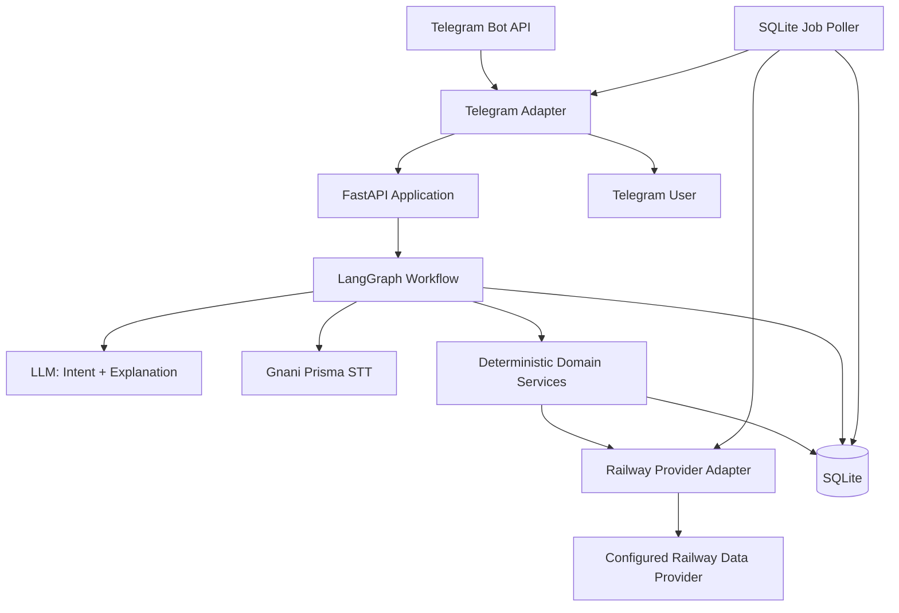

# SAFARIQ — AI-Powered Indian Railway Journey Planner

**Product Requirements Document (PRD)**  
**Version:** 1.0  
**Status:** Build specification for hackathon MVP  
**Prepared:** 1 November 2026  
**Primary interface:** Telegram bot  
**Initial market:** India  
**Project type:** Hackathon prototype; not an IRCTC booking agent  

---

## 0. Instructions to the AI engineering agent

You are the engineering agent responsible for turning this PRD into a working, testable hackathon product. Treat this document as the source of truth. Do not silently remove requirements, invent third-party API capabilities, fabricate railway data, or replace a missing integration with a fake success response.

### Mandatory implementation rules

1. **Build a working vertical slice first.** A user must be able to send a journey request in Telegram, clarify missing details, obtain train results from a configured provider, compare options, select one, and receive a safe official booking handoff.
2. **Do not implement ticket purchase.** SAFARIQ must not log in to IRCTC for the user, collect IRCTC passwords or OTPs, submit payments, bypass CAPTCHA, imitate a user session, or claim to have booked a ticket. The user completes the final booking on an official railway platform.
3. **Never invent live railway facts.** Train numbers, names, stations, schedules, running days, class availability, fares, running status and PNR status must come from a configured provider response. The LLM may interpret and explain those facts, but may not create them.
4. **Keep the data provider replaceable.** No provider-specific fields may leak into Telegram handlers, LangGraph nodes or recommendation logic. Normalize provider responses behind the `RailwayProvider` interface described below.
5. **Use SQLite only.** Do not add Redis, PostgreSQL, Kafka, Celery, Kubernetes or another mandatory infrastructure dependency. Use SQLite for application data, LangGraph checkpoints and scheduled monitoring jobs. Keep database writes short.
6. **Use LangGraph for workflow state, not as a substitute for ordinary code.** Date validation, station matching, fare arithmetic, filtering, ranking, idempotency and provider response validation must be deterministic application code.
7. **Use Gnani only for speech tasks.** Gnani Prisma can transcribe supported speech. It is not the authority for station codes, dates, train schedules, fare or availability. TTS is optional and must not block the MVP.
8. **Every displayed dynamic fact must carry provenance.** Store and expose provider name, retrieval timestamp, data type and freshness. If a value is estimated, label it as estimated. If it cannot be verified, say so.
9. **All dates and times are India-local.** Use `Asia/Kolkata` for user-facing date interpretation and railway times. Store timestamps in UTC internally and store the journey date as an ISO date (`YYYY-MM-DD`).
10. **Never state “100% accurate” or “guaranteed seat”.** The system can guarantee that it reports what a provider returned at a particular time and applies deterministic validation. It cannot guarantee that live availability or a fare remains unchanged until the user completes booking.
11. **Do not start implementation by generating the entire project in one pass.** Follow the build phases in Section 18. Create tests and contracts before wiring live APIs.
12. **If a required credential, provider API or permission is unavailable, stop that integration and report the blocker.** Continue using a clearly labelled demo fixture only in demo mode. Never silently treat demo data as live.

### Build order

Read Sections 1–20 before coding. Then:

- Create the project skeleton, `.env.example`, data models, database migrations and provider interfaces.
- Implement deterministic unit tests and a mock provider.
- Implement direct train search end-to-end using mock data.
- Integrate one approved live railway data provider after verifying its documentation, credentials, commercial/display terms, response fields, limits and freshness.
- Add Gnani voice transcription.
- Add JourneyFit ranking, What-If comparison, booking handoff and optional status monitoring.
- Complete the acceptance tests before polishing message formatting.

---

# 1. Product overview

## 1.1 Product name

**SAFARIQ — Your AI Railway Journey Planner**

Tagline: **“Tell us where you need to go. Understand your best train options. Book safely on the official platform.”**

## 1.2 One-line description

SAFARIQ is a Telegram-first, voice-enabled Indian railway journey assistant that converts natural-language travel requests into verified train options, transparent fare/availability comparisons, explainable recommendations and a prepared official booking handoff.

## 1.3 Problem statement

A traveller often has to perform several manual steps to plan a train journey:

- Determine the correct railway station for a city or locality.
- Find trains between the selected stations on the correct travel date.
- Check whether each train operates on that date.
- Compare departure/arrival times and journey duration.
- Check class-wise availability and quota where supported.
- Obtain a fare quote for the passenger count, class and quota.
- Understand whether an option fits budget, arrival deadline and other preferences.
- Recheck volatile information before booking.
- Transfer the chosen details into the official booking platform.
- Keep track of the journey after booking.

This is cumbersome for people who do not know railway terminology, station codes or which factors matter. A generic LLM chatbot is not sufficient because it may hallucinate train numbers, routes, fares or availability.

SAFARIQ reduces the cognitive work while keeping railway facts tied to a real data provider and keeping the final booking/payment under the user's control.

## 1.4 Product vision

Make railway journey planning conversational and evidence-based. A user should be able to say or type something like:

> “Mujhe 15 November ko Bokaro se Delhi jaana hai. 3AC preferred hai, budget 2,500 ke aas-paas hai, aur subah 9 baje se pehle pahunchna hai.”

SAFARIQ should understand the request, ask only the important missing questions, search current provider data, explain the strongest options, let the user change constraints naturally, and prepare a safe booking handoff.

## 1.5 Product positioning

SAFARIQ is **not** an unofficial ticket-booking website and **not** a replacement for IRCTC, RailOne or NTES. It is a conversational decision-support and journey-preparation layer.

Differentiation should come from:

1. **JourneyFit:** explainable ranking based on the traveller's actual constraints rather than a generic “best train” label.
2. **What-If Journey Simulator:** update recommendations when the user changes a date, budget, departure window, arrival deadline, class or station preference.
3. **Verified booking handoff:** refresh data, prepare exact search details and direct the user to the official booking platform.
4. **Journey Watch (stretch):** after the user voluntarily shares a PNR or selects a train to follow, check supported public status data and notify about significant changes.
5. **Hindi/Hinglish voice-first interaction:** use Gnani Prisma speech-to-text to make the Telegram experience natural for Indian travellers.

---

# 2. Goals, non-goals and success criteria

## 2.1 MVP goals (P0)

- Telegram bot accepts text and voice travel requests.
- Understand origin, destination, journey date and optional travel preferences.
- Normalize city/station names against a provider station directory.
- Ask for clarification where station/date/requirements are ambiguous.
- Search direct trains for a selected date through a configured railway data provider.
- Verify that the provider says each train operates on the requested date.
- Retrieve class availability and fare only when the provider supports those endpoints.
- Clearly label live, estimated, cached, unavailable and demo data.
- Rank results deterministically and explain the score/reasons.
- Allow the user to change a constraint without restarting the conversation.
- Revalidate the selected option immediately before the official handoff.
- Provide a copyable booking summary and an official IRCTC handoff link.
- Persist users, trips, search snapshots, quotes, handoffs and conversation checkpoints in SQLite.
- Handle provider failures, stale data, ambiguous intent, Telegram retries and user cancellation safely.

## 2.2 Stretch goals (P1/P2)

- User-selected multi-station search radius for nearby stations.
- Train running-status lookup through a supported provider/official information source.
- User-initiated PNR status lookup, only if a provider with clear terms supports it.
- Opt-in Journey Watch with low-frequency status checks and Telegram alerts.
- TTS voice replies using Gnani Timbre.
- Multi-leg connection suggestions, only after reliable timetable data and transfer validation exist.
- PDF journey summary or downloadable itinerary.

## 2.3 Explicit non-goals

The MVP must not:

- Book, cancel, modify or pay for a railway ticket.
- Store IRCTC usernames, passwords, OTPs, CAPTCHA answers, UPI PINs, card data or payment credentials.
- Automate an IRCTC browser session or reverse-engineer private endpoints.
- Claim that a public booking deep link pre-populates a train unless such a link is officially documented and tested.
- Predict waitlist confirmation as a certainty.
- Claim exact future platform numbers or arrival times.
- Recommend connecting trains as safe without a deterministic minimum-transfer rule and reliable source data.
- Present cached or fixture data as live.
- Search every nearby station by default without telling the user or obtaining permission.
- Send unsolicited messages to other travellers or groups.

## 2.4 Success metrics for the hackathon

Measure the following in a demo/test dataset. Do not invent metrics in the final presentation.

| Metric | Target for MVP evaluation |
|---|---:|
| Required intent-field extraction accuracy on curated test set | ≥ 95% |
| Correct station resolution when user confirms a candidate | 100% by construction |
| Train results contain required provider provenance | 100% |
| Fabricated train/fare/availability facts | 0 |
| Fare arithmetic unit tests | 100% passing |
| Stale data shown as live | 0 |
| Booking actions initiated by SAFARIQ | 0 |
| Search workflow success with mock provider | ≥ 95% of happy-path tests |
| Duplicate Telegram update handling | 100% idempotent in tests |
| User can change a constraint in the same conversation | Demonstrated live |
| Safe failure when provider is unavailable | Demonstrated live |

The quality objective is **traceable correctness**, not a marketing claim of perfect railway data accuracy.

---

# 3. Target users and primary scenarios

## 3.1 Primary user

An Indian railway passenger who wants to plan a journey quickly using conversational text or voice and may not know station codes, train schedules, quotas or class codes.

## 3.2 Personas

### Persona A — Voice-first traveller

- Speaks Hindi, Hinglish or English.
- Prefers voice notes over typing long requests.
- Needs the agent to repeat critical details before searching.
- Values simple explanations and visible confirmation.

### Persona B — Budget-conscious traveller

- Has a maximum budget.
- Wants to compare travel time and fare.
- May accept a nearby station if it materially improves the journey.
- Needs transparent trade-offs rather than an unexplained recommendation.

### Persona C — Deadline-driven traveller

- Must reach a city before a specific time.
- Cares more about arrival reliability and duration than the cheapest fare.
- Wants options filtered against a hard arrival deadline.

## 3.3 Primary use cases

1. Search direct trains from Bokaro to Delhi on a stated date.
2. Search trains with a specified class and budget.
3. Search trains that arrive before a required time.
4. Compare options by cheapest, fastest and best fit.
5. Change one condition: “Actually, I can leave only after 7 PM.”
6. Search nearby stations after permission: “Also check stations within 40 km.”
7. Open the official booking platform with a prepared search summary.
8. Check a previously selected train's status, if supported.
9. Ask for a PNR status check, if an authorized provider capability exists and the user supplies the PNR.

---

# 4. Scope and release plan

## 4.1 MVP scope: direct train planner + official handoff

The first working version must support one origin station and one destination station, a single travel date, direct trains only, and one passenger by default unless the user specifies another count.

Required search parameters:

- Origin station (resolved to one provider station code).
- Destination station (resolved to one provider station code).
- Journey date.
- Passenger count (default one adult for initial discovery; confirm before fare quote if not explicitly provided).
- Preferred class (optional; if not provided, show available classes returned by the provider or ask the user to select one).
- Quota (default General only when provider supports it; show this default to the user and allow change).
- Optional budget ceiling.
- Optional departure-time window.
- Optional arrival deadline.
- Optional “direct trains only” preference (MVP default is direct only).

The initial search must not silently expand to alternate cities, stations or connecting trains.

## 4.2 P1 scope

- City-wide station candidate expansion after user approval.
- Nearby station radius search using coordinates from a trustworthy station directory.
- Status monitoring for selected train or PNR with provider support.
- TTS voice responses.
- Saved common routes and travel preferences.

## 4.3 P2 scope

- Multi-leg journey planning.
- Minimum transfer-time constraints by station and connection type.
- Disruption recovery across multiple alternate routes.
- Group/family trip comparison.
- Calendar integration, only if requested and authorized.

---

# 5. User experience and Telegram interaction design

## 5.1 Bot commands

Implement these commands:

| Command | Purpose |
|---|---|
| `/start` | Welcome, explain capabilities, privacy and limitations |
| `/help` | Show example requests and supported actions |
| `/plan` | Start a new journey search |
| `/mytrips` | List recent saved trip searches/handoffs |
| `/status` | Check a selected train or saved trip status if supported |
| `/language` | Select English, Hindi or auto-detect for voice |
| `/settings` | Manage default class, passenger count and notification preferences |
| `/cancel` | Cancel the active workflow and clear pending questions/approvals |
| `/privacy` | Explain stored data and delete user data |

Commands should be short and optional; normal conversational input must work without commands.

## 5.2 Conversation flow

### Step 1 — Receive request

Accept:

- Text message.
- Telegram voice note.
- Telegram audio file, within supported size and format limits.

For voice, retrieve the file using Telegram `getFile`, download it securely to a temporary directory, send it to Gnani Prisma STT, parse the transcript, and delete the temporary file after processing unless explicit debugging retention is enabled. Telegram Bot API currently documents a 20 MB maximum file download size through the standard hosted Bot API. Gnani Prisma REST transcription documents clips up to 30 seconds; use that path for short voice notes. Longer audio must be rejected with a helpful message or handled through a supported Gnani batch/realtime path after that integration has been verified.

### Step 2 — Parse intent into a structured object

Expected fields:

```json
{
  "origin_text": "Bokaro",
  "destination_text": "Delhi",
  "journey_date": "2026-11-15",
  "date_was_yearless": true,
  "passenger_count": 1,
  "travel_class": null,
  "quota": "GN",
  "budget_max_inr": null,
  "depart_after": null,
  "depart_before": null,
  "arrive_before": null,
  "direct_only": true,
  "nearby_station_search_km": null,
  "language": "hi-IN",
  "transcript": "...",
  "missing_fields": ["travel_class"],
  "confidence": {
    "origin": 0.94,
    "destination": 0.98,
    "date": 0.99
  }
}
```

This is an illustrative schema. Use Pydantic validation and enums in code. Never use the free-form LLM response directly in business logic.

### Step 3 — Resolve stations

- Search the provider station directory using normalized name, aliases and fuzzy matching.
- Show candidates including station name, code, city/area and state when available.
- If exactly one unambiguous high-confidence candidate exists, it can be preselected but should be displayed in a confirmation summary before live search.
- If multiple plausible candidates exist, ask the user to choose using Telegram inline keyboard buttons.
- Do not infer a station code from an LLM guess.
- A destination city such as “Delhi” may map to multiple stations. Show available Delhi-area station candidates or ask if the user has a preferred station. Do not assume all terminals have equivalent last-mile convenience.
- Store the chosen station code and the human-readable station name separately.

### Step 4 — Resolve date and critical missing constraints

- Interpret yearless dates in `Asia/Kolkata` as the nearest future date matching the user's phrase.
- Always convert the result to an explicit date with year and display it back to the user.
- Reject past dates.
- Check the provider's supported search/booking window; do not hardcode an advance-reservation period.
- If “next Friday”, “tomorrow” or similar phrasing is used, resolve it to an absolute date in IST and show the date.
- Ask for passenger count and class before fare comparison if those values materially affect provider pricing and the user has not supplied them. The initial train discovery may proceed without them if the provider supports schedule-only search.
- Do not ask every possible question upfront. Ask only what blocks the next reliable operation.

### Step 5 — Confirm search summary

Before the first live search, send a compact summary:

- From station and code.
- To station and code.
- Absolute travel date with year.
- Passenger count if known.
- Class and quota if selected.
- Budget/departure/arrival constraints.

Buttons: `Search trains`, `Change stations`, `Change date`, `Change preferences`, `Cancel`.

### Step 6 — Search and present options

- Search direct trains for the resolved station codes and date.
- Normalize provider data.
- Verify provider says the train runs on the specified date.
- Retrieve class availability/fare only for relevant candidates and only when provider supports it.
- Return no more than five ranked options in the initial Telegram response; offer “Show more”.
- Each option must include train number/name, route endpoints, departure, arrival, journey duration, operating-date validation, class, availability status (if available), fare (if available), source and retrieval time.
- Do not mix data from different journey dates or station pairs.

### Step 7 — Change constraints naturally

The user may say:

- “Show only 3AC.”
- “Keep it under ₹2,000.”
- “I can leave only after 6 PM.”
- “I need to arrive before 8 AM.”
- “Also check Bokaro-area stations within 30 km.”
- “Sort by fastest.”

Update only the named constraint. Preserve all other active constraints. Re-run only the affected search steps, but refresh volatile data when a result's fare/availability is displayed or the user selects it.

### Step 8 — Select and refresh

When the user selects a train:

1. Retrieve fresh availability and fare for the exact train, journey date, boarding station, destination station, class, quota and passenger count.
2. Compare the new quote with the quote displayed earlier.
3. If the fare or availability changed, tell the user and ask whether to continue.
4. If the option is no longer available or the provider cannot verify it, do not produce a “ready” handoff as if it were valid. Offer a fresh search.
5. Save a timestamped handoff snapshot.

### Step 9 — Official booking handoff

Show:

- Train number and train name.
- Journey date.
- From/to station codes and names.
- Class and quota.
- Passenger count.
- Last retrieved fare/availability and timestamp.
- A copyable summary.
- A button to open the official IRCTC website (`https://www.irctc.co.in/nget`).
- Optionally display official RailOne information/link after verifying the correct store URL at implementation time.

Explain that IRCTC/RailOne may show a different final fare or availability by the time the user books. The user must log in, enter passenger details, verify the final journey and pay on the official platform. SAFARIQ must not request or store IRCTC credentials, OTPs or payment details.

Do not claim a train has been selected on IRCTC automatically. Unless an official and documented deep-link mechanism is verified, provide a prepared summary and instruct the user to enter the details manually.

### Step 10 — Optional post-booking tracking

User can manually submit a PNR or select “Track this train”.

- PNR tracking is P1 and must only be enabled if the selected data provider exposes a documented and permitted PNR status endpoint.
- Explain that PNR status can change before chart preparation; preserve the status returned by the source and its timestamp.
- Train-running status and PNR status are different data types. Do not confuse scheduled arrival with live expected arrival.
- Monitoring is opt-in. Do not create jobs unless the user has clearly requested tracking.
- If no reliable provider endpoint is configured, provide a link to official enquiry services instead of pretending to monitor.

## 5.3 Telegram message design

Use Telegram inline keyboards for choices that change the current workflow. Avoid large reply-keyboard menus.

Suggested buttons:

- `Search trains`
- `Best overall`
- `Cheapest`
- `Fastest`
- `Show more`
- `Change date`
- `Change class`
- `Nearby stations`
- `Refresh fare & seats`
- `Prepare official booking`
- `Track this train`
- `Cancel search`

Telegram callback payloads must be short, opaque, signed or looked up server-side, and under Telegram's 64-byte `callback_data` limit. Never place passenger PII or a full JSON payload in callback data.

Always call `answerCallbackQuery` promptly after a callback click, even if the main work continues asynchronously.

Use `editMessageText`/`editMessageReplyMarkup` where practical to keep the conversation clean. If a result set is too large, paginate with `Show more`.

## 5.4 Sample interaction

**User:** “I have to travel from Bokaro to Delhi on 15th November.”

**SAFARIQ:** “I understood: Bokaro → Delhi, 15 November 2026. I found more than one possible Delhi-area terminal. Do you have a preferred destination station, or should I include the main Delhi terminals?”

**User:** “Any Delhi station is fine. 3AC, one passenger, under 2500.”

**SAFARIQ:** “Got it. I'll search direct trains from the selected Bokaro station to supported Delhi-area stations, for 1 passenger in 3AC, General quota, up to ₹2,500. Shall I search?”

**SAFARIQ results:** Each train option is grounded in provider data, shows data age and separates schedule from availability/fare.

**User:** “Show the fastest one.”

**SAFARIQ:** Re-ranks the existing valid candidates by verified duration, without inventing any new facts.

**User:** “Prepare booking.”

**SAFARIQ:** Refreshes the fare and availability, shows any changes, prepares a copyable summary and opens the official booking website. No ticket purchase happens inside SAFARIQ.

---

# 6. Functional requirements

Priority legend: **P0 = mandatory MVP**, **P1 = stretch**, **P2 = future**.

## FR-01 Telegram onboarding (P0)

- `/start` must explain SAFARIQ's purpose, what information it uses and that it does not book tickets or collect payment credentials.
- Create a user record keyed by Telegram numeric user ID.
- Store selected language and optional default preferences.
- Do not require email, phone number or IRCTC account to search trains.
- Provide `/privacy` and `/help`.

Acceptance criteria:

- A new user can start and search without a separate account registration.
- Repeated `/start` does not create duplicate users.
- User can request data deletion.

## FR-02 Text intent parsing (P0)

- Parse origin, destination, date, time constraints, class, quota, passenger count, budget and route preferences.
- Output strict structured JSON matching a Pydantic schema.
- Preserve original text for audit/debug with PII minimization.
- If a field is missing, leave it null; do not guess.
- If model parsing fails schema validation, retry once with a repair prompt or fall back to a concise clarification question.

Acceptance criteria:

- “Bokaro to Delhi on 15 Nov, 3AC, under 2500” yields correct candidate fields.
- “Delhi to Bokaro tomorrow” resolves date to an explicit IST date and shows it.
- An ambiguous date/station produces a clarification rather than a fabricated code.

## FR-03 Voice request transcription (P0)

- Support Telegram voice notes in a supported format and within documented size/duration limits.
- Use Gnani Prisma v3.0 when configured, via documented STT REST endpoint.
- Keep Gnani API key server-side in an environment variable.
- Include `model=prisma-v3.0` and `language_code=indic-auto` or an explicit selected language, as supported by the configured model.
- Where appropriate, pass railway terms and station names as contextual keyterms, but do not assume keyterms guarantee the transcript.
- Show the transcript or a compact interpretation before using critical entities where ambiguity exists.
- If STT fails, offer text input and do not start a search with a guessed transcript.

Acceptance criteria:

- A Hindi/Hinglish voice request is transcribed and parsed.
- A low-confidence origin/date leads to confirmation.
- Missing/invalid API key produces a graceful text-mode fallback.

## FR-04 Station resolution (P0)

- Use provider station directory or a vetted local station master dataset with source/version metadata.
- Normalize Unicode, punctuation, whitespace and common aliases.
- Support fuzzy search to return candidates, not to auto-confirm low-confidence matches.
- Preserve station code, canonical name, aliases, city, state and optional lat/long if licensed and available.
- City groups must be explicit sets in configuration and source-backed; do not infer them from text alone.

Acceptance criteria:

- “Bokaro” returns candidate station(s) and the bot displays the selected code.
- “Delhi” can return multiple terminals when provider supports them.
- Unknown station produces suggestions or a request for exact station name; it must not call the train API with a guessed code.

## FR-05 Date/time resolution (P0)

- Parse relative dates using `Asia/Kolkata`.
- Resolve yearless dates to nearest future matching date.
- Show absolute date including year before search.
- Reject dates in the past.
- Enforce provider's available search horizon based on provider response/configuration, not a hardcoded railway rule.
- Correctly calculate arrival date/day offset for journeys crossing midnight, using timetable/provider data.
- Treat railway scheduled times as IST.

Acceptance criteria:

- A yearless date is resolved and echoed.
- Past date is rejected with a helpful message.
- A train arriving after midnight displays the correct arrival date.

## FR-06 Railway provider adapter (P0)

Provide a provider abstraction with methods equivalent to:

```python
class RailwayProvider(Protocol):
    async def search_trains(self, request: TrainSearchRequest) -> list[TrainSearchResult]: ...
    async def get_train_schedule(self, train_number: str) -> TrainSchedule | None: ...
    async def get_availability(self, request: AvailabilityRequest) -> AvailabilityResult | None: ...
    async def get_fare(self, request: FareRequest) -> FareQuote | None: ...
    async def get_live_status(self, request: LiveStatusRequest) -> LiveTrainStatus | None: ...
    async def get_pnr_status(self, pnr: str) -> PnrStatus | None: ...
    async def search_stations(self, query: str) -> list[StationCandidate]: ...
```

All methods may return “unsupported” for capabilities the chosen provider does not offer. This is valid and must not be silently replaced with guessed data.

Requirements:

- One concrete provider for MVP.
- Mock provider for tests/demo.
- Provider health check and circuit-breaker-like cooldown for repeated failures.
- Configurable request timeout, retry policy and rate limit.
- Normalize provider responses into internal Pydantic types.
- Save a provider request ID if returned.
- Save retrieval timestamp, provider ID and response freshness.
- Never log API keys or full raw PNRs.

## FR-07 Train search and service-day validation (P0)

- Search the selected origin/destination station pair and date.
- A train search result must include train number, name, source, destination, departure/arrival, duration, run days and classes if returned by provider.
- Validate that the train operates on the requested boarding date using provider schedule/run-day data.
- Handle overnight route dates and day offsets; do not assume arrival occurs on the same calendar date.
- Deduplicate exact duplicate train records from one response.
- Do not combine one provider's schedule with another provider's availability unless source/time compatibility has been explicitly validated.

## FR-08 Availability retrieval (P0 when provider supports it)

- Query exact train number, origin/boarding station, destination station, journey date, class, quota and passenger count when required by provider.
- Preserve source's availability status code and display label.
- Distinguish confirmed availability, RAC, waitlist, unavailable, regret/no booking, unknown and unsupported.
- Never convert a waitlist prediction into confirmed availability.
- Store `retrieved_at` and `expires_at`/freshness threshold.
- If provider returns a count, show the count only if its meaning is clear and current.
- If no availability API is configured, label availability “Not verified” and do not imply seats are available.

## FR-09 Fare retrieval and calculation (P0 when provider supports it)

- Query exact train, journey date, boarding/destination stations, class, quota, passenger count and passenger category parameters required by provider.
- Store the provider-returned fare as integer paise or Decimal, not binary float.
- Store fare components separately only when the provider actually returns them.
- If provider returns only a total, show only that total; do not invent a breakup.
- Keep booking-provider convenience fees separate from railway fare if such fees are returned by the source.
- Label estimates as “estimated”; do not label an estimated fare as exact.
- Before booking handoff, refresh the fare and compare with the earlier quote.
- If quote changes beyond a configurable threshold or any amount changes, explicitly show the updated amount and require the user to acknowledge it before handoff.

Acceptance criteria:

- Fare calculation is deterministic and unit-tested.
- The app does not calculate fare from distance or an LLM formula.
- No quote is shown without provider and retrieval metadata.

## FR-10 JourneyFit ranking (P0)

Ranking must be implemented in deterministic Python code, not by an LLM.

1. Apply hard constraints first: date validity, station pair, allowed class, budget ceiling (if hard), arrival deadline (if hard), direct-only preference, and provider-valid status.
2. Rank remaining candidates using normalized factors:
   - Total fare (lower is better).
   - Journey duration (shorter is better).
   - Departure/arrival fit to user-selected windows.
   - Transfer count (MVP direct-only means zero).
   - Availability status (only as a preference factor, never a guarantee).
   - Destination station preference.
3. Use deterministic weights stored in config and explain them.
4. If the user says “best” but gives no preferences, use neutral default weights and label the result “Best balanced match”, not objectively best.
5. If no option satisfies all hard constraints, return no exact match and offer controlled relaxation (e.g., increase budget, allow a nearby station, shift date). Never silently relax constraints.
6. Provide an explanation with evidence: “Ranked first because it meets your arrival deadline, is within your budget and has the shortest verified duration among matching options.”

## FR-11 What-If simulator (P1, but include if time permits)

- Re-run affected filters/ranking after the user changes one or more constraints.
- Compare old vs new results and explain what changed.
- Examples: “What if I travel one day later?”, “What if I choose Sleeper?”, “What if I allow a different Delhi station?”
- Do not reuse old availability/fare as live after the date/class/station changes.

## FR-12 Booking handoff (P0)

- Handoff is the final product action; no automated ticket booking.
- Revalidate selected train schedule, fare and availability when supported.
- Create a `booking_handoff` record with selected trip, train, stations, date, class, quota, passenger count, latest quote, availability, retrieval time and official destination URL.
- Present a summary with a copy button/text users can copy.
- Open only the official IRCTC website URL configured in application settings; do not accept arbitrary user-supplied redirect URLs.
- Tell the user to complete all passenger details and payment on the official platform.
- Do not store or ask for IRCTC passwords, OTPs, payment credentials or sensitive identity details.
- Never claim `Booked`, `Ticket confirmed`, or provide a PNR from the handoff.

## FR-13 Train/PNR status monitoring (P1)

- Implement only if the chosen provider supports documented, permitted status endpoints.
- User must opt in to monitoring.
- PNR may be submitted as text or extracted from a ticket attachment in future; if extracted, ask user to verify it.
- Store PNR encrypted at rest using an environment-provided encryption key; mask it in chat/logs.
- Do not store passenger names or full ticket images unless necessary and explicitly consented to.
- Delete PNR and trip monitoring data after the configured retention window (default: 7 days after journey date) or on user request.
- Store status snapshots with source/time. Distinguish booking status from current status and from chart status.
- If provider is unavailable, show the last successful check time and link to official PNR enquiry; do not repeat stale status as current.

## FR-14 User preferences and privacy (P0)

- Store optional default language, passenger count, preferred class and ranking preference.
- Ask before saving a preference learned from a one-off request.
- Provide `/privacy` with current data categories and deletion instructions.
- User can delete recent search data and saved PNR monitoring data.
- No public group-chat mode in MVP. Use private chats only to avoid accidental disclosure of travel data.

## FR-15 Demo mode (P0)

- Include `DEMO_MODE=true` for local/hackathon testing.
- Demo provider fixtures must be visibly marked “DEMO DATA — NOT LIVE”.
- Demo output must never contain plausible-looking live claims without the banner.
- Production/live mode must refuse to search if no valid live provider is configured.

---

# 7. Railway data accuracy and provenance model

This section is a core product requirement.

## 7.1 Data categories must remain distinct

| Category | Meaning | Can be cached? | Display rule |
|---|---|---|---|
| Static station directory | Station names/codes/aliases | Yes, with version/source | Show canonical station code/name |
| Scheduled timetable | Published departure/arrival/halts | Yes, with source/version | Label as scheduled, not live |
| Run-day/service date | Whether the train operates on a date | Short cache or provider validation | Must validate selected journey date |
| Seat availability | Provider's current class/quota status | Very short cache; preferably refresh on selection | Always show retrieved time |
| Fare quote | Provider's fare/estimate for exact request | Very short cache; refresh before handoff | Label exact/estimated based on provider contract |
| Live running status | Actual/expected position/delay | Short cache | Show expected vs scheduled clearly |
| PNR status | Current passenger booking status | No long cache | Show check timestamp and status semantics |

## 7.2 Provenance fields for every provider result

At minimum:

```json
{
  "provider_id": "configured_provider_name",
  "provider_request_id": "if_returned",
  "retrieved_at": "2026-11-01T12:00:00Z",
  "data_type": "availability",
  "is_live": true,
  "is_estimate": false,
  "freshness_seconds": 0,
  "raw_status": "provider_value",
  "normalized_status": "CONFIRMED_OR_OTHER_ENUM"
}
```

Use actual timestamps; never put illustrative timestamps in live mode.

## 7.3 Freshness policy

Use configurable freshness thresholds per data type. Suggested starting defaults (tune after provider documentation and demo testing):

- Station directory: 30 days or provider version lifetime.
- Static schedule: 24 hours, unless provider states a different update cadence.
- Run-day validation: refresh for each new search session.
- Availability: refresh on result selection and immediately before handoff; never rely on a long-lived cache.
- Fare: refresh on result selection and immediately before handoff.
- Live running status: refresh at user request or monitoring interval permitted by provider.
- PNR status: refresh at user request or scheduled interval permitted by provider.

If the provider does not return a source update timestamp, use the local retrieval time but label it as retrieval time, not upstream last-updated time.

## 7.4 Data source selection gate

Before choosing a live provider, verify all the following:

- Does it permit this use case and the display of its data to end users?
- Is use permitted in a hackathon demo and public presentation?
- Is there a documented train-between-stations endpoint?
- Is the schedule date-aware and does it support run days/day offsets?
- Are station aliases and station codes provided?
- Are class-wise availability and quota supported?
- Is fare available for the exact class/quota/date/passenger parameters?
- Does it expose source timestamps or a freshness contract?
- Are there rate limits, a free/demo plan and clear pricing?
- Does it expose live status and PNR endpoints if those are needed?
- What are its uptime/support terms and error schemas?
- Is there evidence of authorization/legitimate data access, or at least explicit provider terms permitting the use?

**Do not assume a third-party railway API is official or IRCTC-authorized simply because it advertises railway data.** Review terms and obtain written clarification if the terms are unclear. Do not scrape private endpoints or reverse-engineer app traffic.

If no provider offers all fields, implement capability flags and show partial results honestly. Example: show train schedules but say “Fare/availability not available from configured provider.”

### Provider leads to evaluate (not endorsements)

The following developer-facing services surfaced during research and may be evaluated for a hackathon prototype:

- [RailKit API documentation](https://railkit.in/docs) describes train-between-stations, schedule, availability, fare and station lookup operations.
- [Qrail developer API](https://www.qrail.in/developers) describes train-between-stations, schedule, PNR and running-status plans, with fare/availability described in a higher tier.
- [RailRadar API documentation](https://railradar.in/docs/trains-between-stations) describes train-between-stations and separate seat-availability endpoints.

These are **unverified provider leads, not official IRCTC APIs and not endorsements**. Before selecting one, test its actual responses, determine its upstream data source, verify current pricing/rate limits, read its terms, establish whether consumer-facing display and hackathon use are permitted, and ask the provider for written clarification where needed. Do not assume “live” in marketing copy means a guaranteed upstream refresh. Store the provider's own timestamp if supplied and your local retrieval timestamp in all cases.

The official Indian Railways Passenger Reservation Enquiry and NTES services are useful reference/verification destinations for users, but their public websites are not automatically a supported developer API. Do not scrape them or automate browser forms as a substitute for a permitted data integration.

---

# 8. Fare, availability and ranking logic

## 8.1 Passenger and quote correctness

Fare and availability queries may depend on passenger count, age category, concessions, class, quota, source/destination segment and date. The provider's request schema is authoritative. Do not invent fields or assumptions.

MVP simplification:

- Initial search may assume one adult only for timetable discovery.
- Before fare retrieval, ask for passenger count and any provider-required passenger category fields.
- For fare quote, use one passenger or the exact passenger mix provided by user.
- Do not request unnecessary identity details because final booking is completed on the official platform.

## 8.2 Money representation

- Use Python `Decimal` for calculations.
- Store amounts as integer paise in SQLite where possible (`amount_paise INTEGER`).
- Do not use binary floating-point for fare arithmetic.
- Do not calculate taxes/fees not returned by the data provider.
- Formatting to rupees happens only in presentation code.

## 8.3 Availability normalization

Create an enum with at least:

- `AVAILABLE_CONFIRMED`
- `RAC`
- `WAITLIST`
- `NOT_AVAILABLE`
- `REGRET_OR_CLOSED`
- `UNKNOWN`
- `UNSUPPORTED`

Preserve the original provider status string in `raw_status`. Do not over-normalize unfamiliar status codes; map them to `UNKNOWN` and show the source value safely.

## 8.4 Ranking policy

Hard constraints must be applied before scoring. Example configurable weights for a default balanced profile:

- Price: 30%
- Journey duration: 25%
- Arrival/departure time fit: 25%
- Availability category: 10%
- Preferred terminal/other convenience: 10%

Weights may be changed by user intent (e.g. “cheapest” makes price the primary weight). Availability should not dominate a recommendation where it is unknown.

The output must include human-readable reasons and must not imply guarantee. Score should be shown only if the model is deterministic and the underlying features are present; otherwise show labels such as “Best budget fit” or “Fastest matching option.”

---

# 9. LangGraph agent design

## 9.1 Design principle

Use one primary state graph with deterministic nodes and a small number of LLM calls. Do not implement a swarm of agents for a straightforward travel planning task.

The LLM is used for:

- Understanding natural language.
- Parsing conversational changes.
- Formulating concise clarification questions.
- Explaining grounded comparisons.
- Handling Hindi/English/Hinglish phrasing.

Deterministic code is used for:

- Pydantic schema validation.
- Date calculation.
- Station resolution and confidence thresholds.
- API calling.
- Response normalization.
- Train run-day validation.
- Fare arithmetic.
- Hard filtering and scoring.
- Staleness checks.
- Handoff construction.
- Monitoring scheduling.

## 9.2 Graph nodes

Recommended graph:

1. `receive_message`
2. `classify_input` — text, voice, command, callback, PNR/status request.
3. `transcribe_voice` — call Gnani only when input is audio.
4. `parse_travel_intent` — structured LLM output.
5. `validate_intent` — deterministic Pydantic/date checks.
6. `resolve_origin_station`
7. `resolve_destination_station`
8. `resolve_missing_constraints`
9. `confirm_search_parameters` — interrupt/wait for user if required.
10. `search_direct_trains`
11. `validate_service_date`
12. `fetch_relevant_availability_and_fares` — based on user-selected class/constraints and provider limits.
13. `normalize_results`
14. `filter_hard_constraints`
15. `rank_journeys`
16. `compose_grounded_results`
17. `await_user_selection` — interrupt/wait for Telegram callback/message.
18. `refresh_selected_option`
19. `prepare_booking_handoff`
20. `save_handoff`
21. `send_handoff_summary`
22. Optional `create_monitoring_job` and `check_status` nodes.

Conditional edges must route to clarification when required fields are missing, and to safe failure when the provider cannot verify a required fact.

## 9.3 Graph state

Use a typed state object with fields such as:

- `telegram_user_id`
- `chat_id`
- `thread_id`
- `active_trip_id`
- `raw_user_message`
- `transcript`
- `parsed_intent`
- `origin_candidates`
- `selected_origin`
- `destination_candidates`
- `selected_destination`
- `missing_fields`
- `clarification_question`
- `provider_id`
- `search_session_id`
- `train_results`
- `selected_train_id`
- `fare_quote_id`
- `availability_result_id`
- `ranking_reasons`
- `handoff_id`
- `error_code`
- `user_action_required`

Do not put secrets, raw API keys, full payment information or unnecessary PII into LangGraph checkpoints.

## 9.4 Persistence and interrupts

- Use `thread_id = telegram_user_id + ':' + chat_id` or a generated per-trip thread ID; do not use a public username as identity.
- Use LangGraph's SQLite checkpointer (`langgraph-checkpoint-sqlite`) for lightweight checkpoint persistence. The async saver requires `aiosqlite` and is intended for local/demo/lightweight workloads, not high-scale production.
- Use LangGraph interrupt/resume semantics for clarification and result selection only if the Telegram adapter can persist and resume correctly.
- Store authoritative business state in normalized SQLite tables as well; do not rely exclusively on serialized LangGraph state.
- Restrict checkpoint serialization to safe types according to current LangGraph package guidance.

## 9.5 Tool definitions

Expose narrow tools, not one generic “do everything” tool:

- `search_stations(query)`
- `get_station_details(station_code)`
- `search_trains(origin_code, destination_code, date)`
- `get_train_schedule(train_number)`
- `get_availability(train_number, from_code, to_code, date, class_code, quota, passenger_params)`
- `get_fare(train_number, from_code, to_code, date, class_code, quota, passenger_params)`
- `get_live_status(train_number, date)`
- `get_pnr_status(pnr)` — P1, disabled unless provider supports it
- `refresh_quote(option_id)`
- `prepare_official_handoff(option_id)`

Each tool must validate input, return typed output, carry provenance and raise typed errors.

---

# 10. Technical architecture and stack

## 10.1 Recommended stack

Use a single-language backend to avoid integration overhead.

| Layer | Recommended choice | Why |
|---|---|---|
| Runtime | Python 3.12+ | Gnani documentation includes Python examples/SDK; strong date/data ecosystem |
| API | FastAPI | Health checks, webhook endpoint and clean service boundaries |
| Telegram | One framework: `aiogram` or `python-telegram-bot` | Use either one, not both |
| Agent orchestration | LangGraph | Stateful workflows, interrupts and resumable steps |
| Model/tool integrations | LangChain | Model abstraction and structured outputs/tools |
| Validation | Pydantic v2 | Strict typed boundaries |
| HTTP client | `httpx` async | Timeouts, pooling and typed API adapters |
| Database | SQLite + SQLAlchemy 2.x/SQLModel (choose one) | Application records |
| Async SQLite driver | `aiosqlite` | Async DB calls and LangGraph AsyncSqliteSaver |
| Scheduling | Single-process asyncio polling loop or APScheduler with SQLite-backed jobs | No Redis requirement |
| Tests | pytest + pytest-asyncio + respx/httpx mocks | Deterministic integration/unit tests |
| Logs | Python `logging` with structured JSON formatter | Traceability |

Do not add a React/web dashboard in MVP. Telegram is the interface. A small admin/debug route may be protected and disabled by default.

## 10.2 System overview



## 10.3 Deployment modes

### Development/hackathon laptop

- Use Telegram long polling OR a local HTTPS tunnel + webhook; do not run both simultaneously.
- `DEMO_MODE=true` until live provider credentials and permission are verified.
- One app instance and one scheduler loop share the same local SQLite file.
- Store DB on a local filesystem, not a network filesystem.

### Hosted demo

- Use HTTPS webhook if deployment has a stable public HTTPS URL.
- Keep a single scheduler owner for the SQLite DB.
- If multiple app instances are used, SQLite is no longer the correct shared coordination layer; for this hackathon, do not scale horizontally.
- Back up SQLite before demo and restore seed data using migrations/fixtures.

## 10.4 SQLite configuration

Recommended pragmas:

```sql
PRAGMA journal_mode = WAL;
PRAGMA foreign_keys = ON;
PRAGMA busy_timeout = 5000;
PRAGMA synchronous = NORMAL;
```

Rules:

- Use one DB file on local disk.
- Keep write transactions short.
- Never hold a transaction open while waiting for an LLM or railway provider.
- Add indexes for user ID, trip ID, search session, created timestamp and due monitoring jobs.
- Configure retention/cleanup for raw responses and logs.
- Back up the database file consistently; do not copy only the main DB file while WAL writes are active without using SQLite's backup API or a safe checkpoint/backup process.

SQLite WAL supports concurrent readers and a writer, but SQLite still has one writer at a time. This architecture is for a single-host hackathon prototype, not a horizontally scaled high-write production platform.

---

# 11. Data model and SQLite schema

Use migrations (Alembic or a simple versioned migration runner). Do not create schema ad hoc inside request handlers.

## 11.1 Tables

### `users`

- `id` INTEGER PRIMARY KEY
- `telegram_user_id` TEXT UNIQUE NOT NULL
- `telegram_chat_id` TEXT NOT NULL
- `language_preference` TEXT DEFAULT 'auto'
- `default_passenger_count` INTEGER DEFAULT 1
- `preferred_class` TEXT NULL
- `preferred_quota` TEXT DEFAULT 'GN'
- `created_at` TEXT NOT NULL
- `updated_at` TEXT NOT NULL
- `is_active` INTEGER DEFAULT 1

### `processed_updates`

- `update_id` TEXT PRIMARY KEY
- `telegram_user_id` TEXT NOT NULL
- `processed_at` TEXT NOT NULL
- `result_status` TEXT NOT NULL

Purpose: Telegram update idempotency. A repeated update must not create duplicate trips or handoffs.

### `conversations`

- `id` TEXT PRIMARY KEY
- `telegram_user_id` TEXT NOT NULL
- `thread_id` TEXT NOT NULL
- `active_trip_id` TEXT NULL
- `last_message_at` TEXT NOT NULL
- `created_at` TEXT NOT NULL
- `updated_at` TEXT NOT NULL

### `trip_requests`

- `id` TEXT PRIMARY KEY (UUID)
- `telegram_user_id` TEXT NOT NULL
- `origin_query` TEXT NULL
- `origin_station_code` TEXT NULL
- `origin_station_name` TEXT NULL
- `destination_query` TEXT NULL
- `destination_station_code` TEXT NULL
- `destination_station_name` TEXT NULL
- `journey_date` TEXT NULL (`YYYY-MM-DD`, null while intent is incomplete)
- `passenger_count` INTEGER NULL
- `class_code` TEXT NULL
- `quota_code` TEXT NULL
- `budget_max_paise` INTEGER NULL
- `depart_after_local` TEXT NULL
- `depart_before_local` TEXT NULL
- `arrive_before_local` TEXT NULL
- `direct_only` INTEGER NOT NULL DEFAULT 1
- `nearby_radius_km` REAL NULL
- `status` TEXT NOT NULL
- `intent_json` TEXT NOT NULL
- `created_at` TEXT NOT NULL
- `updated_at` TEXT NOT NULL

### `search_sessions`

- `id` TEXT PRIMARY KEY
- `trip_request_id` TEXT NOT NULL
- `provider_id` TEXT NOT NULL
- `status` TEXT NOT NULL
- `requested_at` TEXT NOT NULL
- `completed_at` TEXT NULL
- `provider_request_id` TEXT NULL
- `result_count` INTEGER DEFAULT 0
- `error_code` TEXT NULL
- `error_message_safe` TEXT NULL
- `is_demo` INTEGER NOT NULL DEFAULT 0

### `train_options`

- `id` TEXT PRIMARY KEY
- `search_session_id` TEXT NOT NULL
- `provider_id` TEXT NOT NULL
- `train_number` TEXT NOT NULL
- `train_name` TEXT NOT NULL
- `origin_station_code` TEXT NOT NULL
- `destination_station_code` TEXT NOT NULL
- `departure_datetime_ist` TEXT NULL
- `arrival_datetime_ist` TEXT NULL
- `duration_minutes` INTEGER NULL
- `run_day_validated` INTEGER NOT NULL DEFAULT 0
- `available_classes_json` TEXT NULL
- `provider_raw_status` TEXT NULL
- `source_retrieved_at` TEXT NOT NULL
- `is_demo` INTEGER NOT NULL DEFAULT 0
- `raw_response_json` TEXT NULL (only if terms/privacy permit; redact)

### `availability_snapshots`

- `id` TEXT PRIMARY KEY
- `train_option_id` TEXT NOT NULL
- `class_code` TEXT NOT NULL
- `quota_code` TEXT NOT NULL
- `passenger_count` INTEGER NOT NULL
- `raw_status` TEXT NOT NULL
- `normalized_status` TEXT NOT NULL
- `available_count` INTEGER NULL
- `provider_id` TEXT NOT NULL
- `provider_request_id` TEXT NULL
- `retrieved_at` TEXT NOT NULL
- `is_estimate` INTEGER NOT NULL DEFAULT 0
- `is_demo` INTEGER NOT NULL DEFAULT 0

### `fare_quotes`

- `id` TEXT PRIMARY KEY
- `train_option_id` TEXT NOT NULL
- `class_code` TEXT NOT NULL
- `quota_code` TEXT NOT NULL
- `passenger_count` INTEGER NOT NULL
- `total_fare_paise` INTEGER NULL
- `components_json` TEXT NULL
- `currency` TEXT NOT NULL DEFAULT 'INR'
- `quote_type` TEXT NOT NULL (`EXACT`, `ESTIMATED`, `UNKNOWN`)
- `provider_id` TEXT NOT NULL
- `provider_request_id` TEXT NULL
- `retrieved_at` TEXT NOT NULL
- `is_demo` INTEGER NOT NULL DEFAULT 0

### `ranking_snapshots`

- `id` TEXT PRIMARY KEY
- `search_session_id` TEXT NOT NULL
- `train_option_id` TEXT NOT NULL
- `rank` INTEGER NOT NULL
- `label` TEXT NOT NULL
- `score` REAL NULL
- `reasons_json` TEXT NOT NULL
- `created_at` TEXT NOT NULL

### `booking_handoffs`

- `id` TEXT PRIMARY KEY
- `telegram_user_id` TEXT NOT NULL
- `trip_request_id` TEXT NOT NULL
- `train_option_id` TEXT NOT NULL
- `fare_quote_id` TEXT NULL
- `availability_snapshot_id` TEXT NULL
- `official_url` TEXT NOT NULL
- `handoff_summary_json` TEXT NOT NULL
- `acknowledged_by_user` INTEGER NOT NULL DEFAULT 0
- `created_at` TEXT NOT NULL
- `expires_at` TEXT NOT NULL

This is a handoff record, not a booking record. Do not store a fake PNR.

### `monitoring_jobs` (P1)

- `id` TEXT PRIMARY KEY
- `telegram_user_id` TEXT NOT NULL
- `job_type` TEXT NOT NULL (`TRAIN_STATUS`, `PNR_STATUS`)
- `target_reference_encrypted` TEXT NULL
- `train_number` TEXT NULL
- `journey_date` TEXT NULL
- `interval_seconds` INTEGER NOT NULL
- `next_run_at` TEXT NOT NULL
- `last_run_at` TEXT NULL
- `last_status_hash` TEXT NULL
- `status` TEXT NOT NULL (`ACTIVE`, `PAUSED`, `COMPLETED`, `FAILED`, `CANCELLED`)
- `created_at` TEXT NOT NULL
- `updated_at` TEXT NOT NULL

### `provider_events`

- `id` TEXT PRIMARY KEY
- `provider_id` TEXT NOT NULL
- `operation` TEXT NOT NULL
- `request_id` TEXT NULL
- `http_status` INTEGER NULL
- `error_code` TEXT NULL
- `duration_ms` INTEGER NULL
- `created_at` TEXT NOT NULL

Do not log secrets, raw PNRs, passenger details or full private documents.

### `agent_checkpoints`

Managed by LangGraph's SQLite checkpointer package. Keep its namespace/thread IDs scoped to the Telegram user/trip. Do not manually edit checkpoint tables.

## 11.2 Indexes

At minimum:

- `users(telegram_user_id)` UNIQUE
- `processed_updates(update_id)` PRIMARY KEY
- `trip_requests(telegram_user_id, created_at)`
- `search_sessions(trip_request_id, requested_at)`
- `train_options(search_session_id)`
- `fare_quotes(train_option_id, retrieved_at)`
- `availability_snapshots(train_option_id, retrieved_at)`
- `monitoring_jobs(status, next_run_at)`
- `booking_handoffs(telegram_user_id, created_at)`

## 11.3 Retention

- Conversation history: configurable; default 90 days for hackathon unless the user deletes it earlier.
- Raw provider responses: default 7 days, only if provider terms permit and data is useful for debugging.
- Fare/availability snapshots: keep only long enough to compare a handoff and troubleshoot; mark as historical.
- PNR: P1 only; encrypt and delete by default 7 days after journey date or immediately on user request.
- Audio files: delete immediately after transcription unless a user explicitly opts into a debug upload; never keep voice recordings by default.
- Logs: never include credentials, full PNR, passenger name, phone number, ticket PDF content or raw audio.

---

# 12. External API contracts

## 12.1 Railway provider interface

Create a `RailwayProvider` protocol and a `RailwayProviderRegistry` selected by environment configuration.

```python
class RailwayProvider(Protocol):
    provider_id: str
    capabilities: ProviderCapabilities

    async def search_stations(self, query: str) -> list[StationCandidate]: ...
    async def search_trains(self, request: TrainSearchRequest) -> list[TrainSearchResult]: ...
    async def get_train_schedule(self, train_number: str) -> TrainSchedule | None: ...
    async def get_availability(self, request: AvailabilityRequest) -> AvailabilityResult | None: ...
    async def get_fare(self, request: FareRequest) -> FareQuote | None: ...
    async def get_live_status(self, request: LiveStatusRequest) -> LiveTrainStatus | None: ...
    async def get_pnr_status(self, pnr: str) -> PnrStatus | None: ...
```

`ProviderCapabilities` must expose booleans for station search, train search, schedule, date-specific run-days, availability, fare, live status, PNR status and nearby-station support.

Do not implement methods by scraping consumer webpages. Use documented API endpoints under terms that permit this use.

## 12.2 Required normalized data models

### StationCandidate

- `code: str`
- `name: str`
- `city: str | None`
- `state: str | None`
- `aliases: list[str]`
- `latitude: float | None`
- `longitude: float | None`
- `provider_id: str`
- `retrieved_at: datetime`

### TrainSearchResult

- `train_number: str`
- `train_name: str`
- `from_station_code: str`
- `from_station_name: str`
- `to_station_code: str`
- `to_station_name: str`
- `departure_time_local: time | None`
- `arrival_time_local: time | None`
- `arrival_day_offset: int | None`
- `duration_minutes: int | None`
- `running_days: list[int] | None`
- `classes: list[str] | None`
- `service_date_validated: bool`
- `provider_id: str`
- `retrieved_at: datetime`
- `is_estimate: bool`

### AvailabilityResult

- `raw_status: str`
- `normalized_status: AvailabilityStatus`
- `available_count: int | None`
- `class_code: str`
- `quota_code: str`
- `passenger_count: int`
- `provider_id: str`
- `retrieved_at: datetime`
- `is_estimate: bool`

### FareQuote

- `total_amount_paise: int | None`
- `components: list[FareComponent] | None`
- `currency: Literal['INR']`
- `quote_type: Literal['EXACT', 'ESTIMATED', 'UNKNOWN']`
- `class_code: str`
- `quota_code: str`
- `passenger_count: int`
- `provider_id: str`
- `retrieved_at: datetime`

### Provider error

Normalize errors into:

- `AUTH_FAILED`
- `RATE_LIMITED`
- `TIMEOUT`
- `SERVICE_UNAVAILABLE`
- `INVALID_REQUEST`
- `NOT_FOUND`
- `UNSUPPORTED_OPERATION`
- `QUOTA_EXCEEDED`
- `MALFORMED_RESPONSE`
- `UNKNOWN_PROVIDER_ERROR`

## 12.3 Gnani integration

Use Gnani Speech APIs in the backend, never directly from Telegram clients.

Recommended documented endpoint for short voice notes:

- STT endpoint: `POST https://api.vachana.ai/stt/v3`
- Header: `X-API-Key-ID: <GNANI_API_KEY_ID>`
- Multipart fields include `audio_file`, `model=prisma-v3.0`, and `language_code=indic-auto` or a supported explicit language.
- Gnani documentation says REST transcription supports clips up to 30 seconds. Validate Telegram audio duration and file size before calling.
- A successful response includes a transcript and may include detected language and processing metadata.

Use station names or railway vocabulary as optional keyterms only after validating the actual Gnani model request schema. Do not send the entire user profile as context.

TTS is optional:

- Documented endpoint: `POST https://api.vachana.ai/api/v1/tts/inference`
- Header: `X-API-Key-ID`
- Use a currently documented Timbre model and valid audio configuration.
- Add a user preference `/language` or `/settings` for voice replies.
- Text response must remain available even if TTS fails.

Handle Gnani errors by HTTP status and documented error shape. The documentation identifies missing/invalid API key (401), insufficient credit (402), scope not allowed (403), rate limit (429), validation errors (422) and provider/server errors. Retry 429 only with bounded backoff; do not hammer the endpoint. For 401/403/402, do not retry automatically—show text fallback and log a safe diagnostic.

## 12.4 Telegram integration

- Use long polling for local hackathon development or HTTPS webhook for hosted demo. They are mutually exclusive update-delivery methods.
- Maintain update idempotency through `processed_updates`.
- Use `getFile` to download audio and supported attachments; enforce documented limits before download.
- Use inline keyboards for station options, train selection, pagination and confirmation.
- Keep callback data under 64 bytes and store the full state server-side.
- Call `answerCallbackQuery` quickly.
- Handle HTTP 429 and Telegram `retry_after` where returned; queue/retry notifications within bounded limits.
- Avoid more than one message per second to a single chat during normal operation.

---

# 13. Error handling and recovery matrix

All errors must be converted to a user-safe message plus a structured internal error record. Never expose stack traces, API keys or raw provider response bodies to users.

| Failure | Internal handling | User-facing behavior | Retry policy |
|---|---|---|---|
| Telegram update duplicated | Check `processed_updates` | No duplicate response/action | No reprocessing |
| Telegram webhook/polling unavailable | Log update delivery issue; health alert | User may retry later | Telegram delivery strategy only |
| Audio too large | Reject before download | “This voice file is too large. Please send a shorter voice note or type the request.” | No retry |
| Audio longer than Gnani REST limit | Reject or route to verified batch path | Ask for a shorter note or text | No blind chunking |
| Gnani 401/403/402 | Disable voice path for request | Offer text input | No automatic retry |
| Gnani 429 | Backoff with jitter and bounded attempts | “Voice processing is busy; please try again or type it.” | Retry once/twice only within timeout budget |
| Gnani 5xx/504 | Safe fallback | Ask user to resend or type | One bounded retry if request is safe/idempotent |
| Intent JSON invalid | Schema repair or ask user | Clarify the invalid/missing field | At most one model repair attempt |
| Origin ambiguous | Return candidates | Ask the user to select station | No API train search yet |
| Destination ambiguous | Return terminal candidates | Ask user to select/prefer all supported terminals | No API train search until resolved |
| Date in past | Reject validation | Ask for a future date | No retry |
| Date outside provider window | Preserve request; no search | Explain supported window only if known from provider | No retry |
| Railway provider timeout | Mark provider timeout | “I couldn't verify live train data right now.” | One bounded retry; then stop |
| Railway provider 429 | Respect `Retry-After`/provider docs | Explain temporary limit | Backoff; no rapid repeated calls |
| Railway provider 401/403 | Mark integration misconfigured | “Live train search is temporarily unavailable.” | No retry; operator action |
| Railway provider returns malformed data | Reject invalid record | Omit affected result and explain partial data | No blind retry unless transient |
| No direct trains | Empty result | Offer user-approved nearby stations/date change | Do not invent connection |
| Schedule says train not running that day | Filter it | Do not display as valid result | No retry |
| Availability unsupported | Store unsupported state | “Seat availability could not be verified by this source.” | No retry |
| Fare unsupported | Store unsupported state | “Fare quote unavailable; verify on official booking platform.” | No retry |
| Fare is estimated | Label estimated | Never use exact-fare wording | Refresh before handoff if possible |
| Availability becomes stale | Refresh selected train | Show timestamp and refresh result | One refresh call |
| Fare changes after refresh | Save new quote | Show difference and request acknowledgement | Do not silently continue |
| Selected train disappears | Mark unavailable/changed | Offer fresh search | Re-run search only after user agrees |
| User changes date/station/class | Invalidate affected result snapshots | Re-search with updated criteria | No reuse of stale fare/availability |
| Telegram callback expired | Reject old callback token | “These results expired. Please search again.” | No action |
| SQLite locked/busy | Short wait/retry; inspect transaction scope | “I couldn't save this step. Please try again.” | Bounded retry |
| SQLite disk full/readonly | Stop writes safely; alert operator | Explain data couldn't be saved | No repeated write loop |
| Scheduler duplicate job | Unique job key/transaction | One notification only | Idempotent |
| PNR status provider unavailable | Keep last snapshot historical | Show last checked time + official link | Bounded retry at next scheduled time |
| Handoff URL invalid | Validate allowlisted official host | Do not show link | Operator/config error |
| User sends `/cancel` | Mark active graph/trip cancelled | Confirm cancellation | No further action for that workflow |

## 13.1 Retry rules

- Use exponential backoff with jitter for retryable transient errors.
- Maximum two retries for idempotent read operations unless provider docs require stricter limits.
- Do not retry user-visible actions in a way that sends duplicate messages or duplicate database records.
- Never retry a non-idempotent operation blindly. The product does not book tickets, but this rule applies to any future external mutation.
- Add request deadlines and cancellation handling.
- If the user cancels while a request is in progress, stop downstream steps where possible.

## 13.2 Safe degradation

If Gnani is unavailable, text input still works.  
If TTS is unavailable, send text.  
If fare is unavailable, show train schedule results with a clear fare-unavailable label.  
If availability is unavailable, do not imply seats are available.  
If live status is unavailable, show schedule only and link to official status information.  
If the railway provider is unavailable, do not use old snapshots as live; show the last retrieval timestamp or ask the user to retry.

---

# 14. Bottlenecks and mitigation plan

## 14.1 Railway data provider access (highest risk)

**Risk:** No approved API credentials, limited endpoints, restrictive terms, inconsistent schemas or low rate limits.

**Mitigation:**

- Treat provider selection as a project gate before live integration.
- Evaluate API documentation and terms before coding the adapter.
- Use one provider for MVP rather than aggregating many unverified providers.
- Implement `MockRailwayProvider` for development and tests.
- Add capability flags to support partial data.
- Keep the API adapter replaceable.
- Present provider/source and retrieval time for all dynamic facts.
- If no valid provider is available, demonstrate with clearly marked fixture data and live official handoff links; never label fixtures live.

## 14.2 Seat availability and fare volatility

**Risk:** Availability and total amount may change between search and booking.

**Mitigation:**

- Fetch availability/fare after the user narrows to a relevant class/train rather than querying every possible combination.
- Cache only briefly and include retrieval timestamp.
- Force a refresh before preparing handoff.
- Compare fresh quote to displayed quote.
- Ask user to acknowledge changes.
- State clearly that official platform data at booking time is final.

## 14.3 Station ambiguity and city terminals

**Risk:** “Delhi” or “Bokaro” may map to multiple stations or aliases.

**Mitigation:**

- Station directory is the only source of station codes.
- Use aliases and fuzzy match only to propose candidates.
- Ask user when there is more than one plausible station.
- Add city-area groups only as curated, versioned configuration backed by a station dataset.
- Nearby-station expansion must be opt-in and show distance/transport trade-off.

## 14.4 LLM hallucination

**Risk:** LLM invents train names, station codes, ticket prices, seat counts or policies.

**Mitigation:**

- LLM never directly writes final train result payloads.
- Tool outputs are typed and validated.
- Result cards are generated from normalized data models.
- LLM can only explain facts that are present in the context.
- Add tests that inject fake LLM suggestions and assert they are discarded unless provider-backed.

## 14.5 Vibe-coding integration complexity

**Risk:** AI-generated code mixes Telegram handlers, LangGraph state, providers, DB and UI into one module, causing cascading bugs.

**Mitigation:**

- Enforce module boundaries and the repository structure in Section 17.
- Write tests per service before connecting services.
- Give the coding agent one phase/task at a time.
- Ask the coding agent to list changed files and run tests after each phase.
- Require typed contracts and no magic dictionaries between layers.
- Keep `.env.example` updated and all secrets out of version control.
- Use fixed, recorded fixtures for tests.

## 14.6 SQLite concurrency

**Risk:** Long-running API calls overlap DB writes and cause locked database errors.

**Mitigation:**

- WAL mode and `busy_timeout`.
- Single SQLite file on local disk.
- Short transactions.
- No DB transaction around network calls.
- A single scheduler writer loop for monitoring jobs.
- Use async SQLite carefully; keep checkpoint DB access lifecycle clean.
- Back up using SQLite backup API.

## 14.7 API rate limits and latency

**Risk:** Searching fare/availability for every returned train may exhaust free quotas or exceed response time.

**Mitigation:**

- Stage requests: search schedules first, then fetch class/fare/availability for a small candidate set.
- Limit result count and provider concurrency.
- Respect documented rate limits and `Retry-After`.
- Use request timeout and bounded retries.
- Cache static schedule data according to source terms; don't cache availability/fare for long.
- Display partial results rather than failing the entire search if one option lookup fails.

## 14.8 Monitoring load

**Risk:** Frequent polling can exceed provider rate limits and produce noisy Telegram messages.

**Mitigation:**

- P1 feature only.
- User must explicitly opt in.
- Minimum polling interval must respect provider terms and rate limits.
- Notify only on meaningful status changes, not every unchanged response.
- One scheduler process reads due jobs from SQLite.
- Add pause/cancel controls.

## 14.9 Booking handoff confusion

**Risk:** User believes SAFARIQ has booked the ticket or that displayed fare is guaranteed.

**Mitigation:**

- Label the action “Continue on official IRCTC”, not “Book ticket with SAFARIQ”.
- Show a clear disclaimer that booking/payment happen outside SAFARIQ.
- Never generate fake PNRs or booking confirmations.
- Use allowlisted official URL only.
- Revalidate and timestamp the displayed quote.

---

# 15. Security, privacy and responsible behavior

## 15.1 Secrets

- Store Telegram token, Gnani key, LLM key and railway API credentials in environment variables or deployment secret manager.
- Provide `.env.example` with placeholders only.
- Never commit `.env`, SQLite production DB, raw ticket PDFs or logs containing PII.
- Rotate a key if it is accidentally exposed.

## 15.2 User identity

- Use Telegram numeric user ID as primary external identity.
- Do not trust username, display name or user-supplied Telegram ID.
- Private chat only for MVP.
- Prevent one user from reading another user's trip, checkpoint or status.

## 15.3 PII minimization

- Do not collect passenger full name, age, gender, Aadhaar, phone number or identity documents for a booking handoff. The user enters these on the official platform.
- Do not collect IRCTC username/password/OTP/payment data.
- If PNR monitoring is implemented, encrypt the PNR and mask it in all user-facing and internal logs.
- Delete temporary audio files after STT.
- Never send ticket PDFs or PNRs to an LLM unless strictly necessary; prefer deterministic extraction and redaction.

## 15.4 External link safety

- Official booking URL must be a constant allowlisted URL.
- Do not use arbitrary redirect URLs returned by user content or LLM output.
- Display the domain before opening.
- Do not imitate the IRCTC logo or official branding without permission.

## 15.5 User consent

- Ask before saving persistent preferences.
- Ask before creating train/PNR monitoring jobs.
- Ask before any action that sends an external notification or shares user data.
- Provide `/privacy` and `/cancel`.

---

# 16. Non-functional requirements

| Area | Requirement |
|---|---|
| Correctness | Zero invented dynamic train facts; validate every result against provider schema |
| Provenance | Every live value has provider and retrieval time |
| Availability | If provider is down, graceful failure, not fake result |
| Latency | Aim for < 10 seconds for text intent parsing + first response; overall provider search can take longer and should send a progress message |
| Responsiveness | Acknowledge Telegram updates quickly; run long operations asynchronously |
| Persistence | User trip and graph state survives app restart |
| Idempotency | Duplicate Telegram updates/callbacks do not duplicate actions |
| Localization | English, Hindi and Hinglish voice input; bot text may initially respond in detected language with user override |
| Accessibility | Plain-language explanations, compact messages and unambiguous dates |
| Privacy | Private chats only; minimize PII and temporary audio retention |
| Observability | Structured logs with request IDs, provider IDs and safe error codes |
| Maintainability | Provider, agent, data, ranking and Telegram layers are independent |
| Portability | Local laptop demo with `.env` and SQLite; no Redis dependency |

---

# 17. Recommended repository structure

Create a maintainable structure before implementing full behavior:

```text
safariq/
├── README.md
├── PRD.md
├── pyproject.toml
├── uv.lock                       # or requirements lock; use one dependency manager
├── .env.example
├── .gitignore
├── alembic.ini                   # only if Alembic is selected
├── migrations/
├── data/
│   ├── .gitkeep
│   └── fixtures/                 # labelled demo data only
├── scripts/
│   ├── init_db.py
│   ├── seed_demo_data.py
│   └── check_provider.py
├── src/
│   └── safariq/
│       ├── __init__.py
│       ├── main.py               # app lifecycle
│       ├── config.py             # validated env configuration
│       ├── logging_config.py
│       ├── api/
│       │   ├── health.py
│       │   └── webhooks.py
│       ├── telegram/
│       │   ├── bot.py
│       │   ├── handlers/
│       │   │   ├── start.py
│       │   │   ├── travel.py
│       │   │   ├── callbacks.py
│       │   │   ├── settings.py
│       │   │   └── privacy.py
│       │   ├── keyboards.py
│       │   ├── formatter.py
│       │   └── file_download.py
│       ├── speech/
│       │   ├── gnani_client.py
│       │   ├── transcription.py
│       │   └── tts.py
│       ├── agent/
│       │   ├── graph.py
│       │   ├── state.py
│       │   ├── nodes.py
│       │   ├── routing.py
│       │   ├── prompts.py
│       │   └── checkpointer.py
│       ├── domain/
│       │   ├── models.py
│       │   ├── enums.py
│       │   ├── errors.py
│       │   ├── intent.py
│       │   ├── stations.py
│       │   ├── dates.py
│       │   ├── search.py
│       │   ├── availability.py
│       │   ├── pricing.py
│       │   ├── ranking.py
│       │   ├── handoff.py
│       │   └── monitoring.py
│       ├── providers/
│       │   ├── base.py
│       │   ├── registry.py
│       │   ├── configured_provider.py
│       │   └── mock_provider.py
│       ├── database/
│       │   ├── engine.py
│       │   ├── models.py
│       │   ├── repositories/
│       │   └── migrations/
│       ├── scheduler/
│       │   ├── worker.py
│       │   └── jobs.py
│       └── services/
│           ├── trip_service.py
│           ├── search_service.py
│           ├── recommendation_service.py
│           └── notification_service.py
└── tests/
    ├── unit/
    │   ├── test_dates.py
    │   ├── test_station_resolution.py
    │   ├── test_fare_math.py
    │   ├── test_ranking.py
    │   └── test_availability_normalization.py
    ├── integration/
    │   ├── test_provider_adapter.py
    │   ├── test_gnani_client.py
    │   ├── test_telegram_flow.py
    │   └── test_sqlite_persistence.py
    ├── e2e/
    │   └── test_trip_search_to_handoff.py
    └── fixtures/
        ├── trains_bokaro_delhi.json
        ├── availability.json
        └── fares.json
```

Do not create empty abstractions with no purpose. If using a simpler structure, preserve these boundaries.

---

# 18. Vibe-coding implementation workflow

The AI coding assistant must work in small, reviewable phases. It should not overwrite existing files without inspecting them.

## Phase 0 — Discovery and project setup

Tasks:

- Inspect the existing repository and environment.
- Confirm Python version and package manager.
- Confirm the railway data provider, credentials, terms and available operations.
- Confirm Gnani account/API key and allowed speech scopes.
- Confirm whether local long polling or a hosted webhook will be used.
- Create `.env.example`, `.gitignore`, README and skeleton directories.
- Record all unresolved integration blockers in `docs/INTEGRATION_BLOCKERS.md`.

Exit criteria:

- Project installs from lock file.
- No secrets are committed.
- `/health` responds.
- `DEMO_MODE=true` is explicit.

## Phase 1 — Contracts and deterministic domain logic

Tasks:

- Create Pydantic models and enums.
- Implement timezone/date parsing.
- Implement station candidate matching with test fixtures.
- Implement availability status normalization.
- Implement fare integer/Decimal arithmetic.
- Implement hard filters and deterministic ranking.
- Write tests before integrating the LLM.

Exit criteria:

- Unit tests pass.
- No LLM or external API is required to test domain logic.

## Phase 2 — SQLite and LangGraph persistence

Tasks:

- Create migration/schema.
- Create repositories for users, trips, search sessions, train options, snapshots, quotes and handoffs.
- Enable SQLite WAL and foreign keys.
- Add Telegram update idempotency.
- Configure LangGraph SQLite checkpointer and safe serialization settings according to package documentation.
- Test app restart and resume of a pending clarification.

Exit criteria:

- Search state persists after restarting the app.
- Duplicate Telegram updates do not duplicate the trip.

## Phase 3 — Mock provider and search vertical slice

Tasks:

- Implement `MockRailwayProvider` using static JSON fixtures.
- Mark every result as demo.
- Build one text-based search flow through LangGraph.
- Present 3–5 result options and allow selection.
- Prepare a demo official handoff summary.

Exit criteria:

- Entire workflow runs end-to-end without external railway API keys.
- Every demo response is visibly labelled demo.

## Phase 4 — Live railway provider adapter

Tasks:

- Implement the selected provider only after confirming documentation and permission.
- Add authentication from environment variables.
- Add timeouts, rate limiting and bounded retries.
- Validate response schemas and reject malformed records.
- Add provider capability flags.
- Record retrieval timestamp and source on every result.
- Add provider contract tests using recorded sanitized responses.

Exit criteria:

- Live mode requires valid credentials.
- If provider is absent or fails, live mode returns a safe unavailable response.
- No demo fixture appears as live data.

## Phase 5 — Gnani voice integration

Tasks:

- Add Telegram voice download and file validation.
- Add Gnani Prisma v3 STT client.
- Use automatic language detection where suitable.
- Parse transcript through the same intent parser used for text.
- Confirm ambiguous dates/stations.
- Optionally add TTS after text path is stable.

Exit criteria:

- Hindi/Hinglish voice request reaches the same deterministic search workflow as text.
- STT failure falls back to text without losing the user's session.

## Phase 6 — JourneyFit and What-If

Tasks:

- Implement configured scoring and hard constraints.
- Build explanation templates from evidence fields.
- Allow user to change one constraint while preserving others.
- Re-run affected queries and refresh volatile facts.

Exit criteria:

- Same provider data + same request always produces the same ranking.
- “Cheapest”, “fastest” and “best balanced match” are distinct.
- Hard constraints are never silently relaxed.

## Phase 7 — Official booking handoff

Tasks:

- Revalidate fare and availability for selected train.
- Compare refreshed quote to previous quote.
- Generate copyable train search summary.
- Add allowlisted official IRCTC link.
- Add clear external-booking disclaimer.
- Ensure no credential, OTP or payment fields exist in the app.

Exit criteria:

- Handoff can be completed without SAFARIQ receiving sensitive booking credentials.
- No fake ticket/PNR confirmation is emitted.

## Phase 8 — Optional Journey Watch

Tasks:

- Confirm provider supports live status/PNR status and relevant terms.
- Add opt-in monitor jobs.
- Implement a single SQLite-backed scheduler loop.
- Add dedupe for unchanged status and notification rate limits.
- Add pause/cancel and retention cleanup.

Exit criteria:

- Only opted-in journeys are monitored.
- Provider failures do not create false delay/cancellation alerts.

## Phase 9 — Hardening and presentation

Tasks:

- Run all tests.
- Test wrong station, date, class, empty results, expired fare, timeouts and provider outages.
- Check all dynamic values have source/timestamp.
- Verify demo/live labels.
- Prepare one realistic end-to-end Telegram presentation.
- Prepare a failure demonstration to show safe degradation.

Exit criteria:

- All P0 acceptance criteria pass.
- No critical correctness or privacy defect remains.

---

# 19. Test plan and acceptance checklist

## 19.1 Intent/date tests

- “Bokaro to Delhi on 15 November” → date resolved to nearest future date in IST and echoed with year.
- “Tomorrow from Bokaro to Delhi” → date is computed using `Asia/Kolkata`.
- Past date → rejected.
- Date outside provider's supported window → no fabricated availability.
- “Leave after 7 PM” → departure lower bound set.
- “Reach before 9 AM” → arrival deadline set.
- “Under 2500” → budget maximum set in paise.
- Hindi/Hinglish transcript with numeric date → user confirmation if ambiguous.

## 19.2 Station tests

- Exact provider station code resolves correctly.
- Common alias resolves to candidate list.
- Ambiguous city name asks user to choose.
- No station match asks for a better name.
- Nearby station expansion is not run without user permission.

## 19.3 Train data tests

- Train running day validated for selected date.
- Overnight arrival correctly displays next-day date.
- Provider duplicate results deduplicated.
- Malformed train record rejected.
- Unknown class code preserved safely and not presented as familiar class.
- Schedule-only provider never implies live seat availability.

## 19.4 Fare/availability tests

- Fare uses Decimal/integer paise.
- No float arithmetic.
- Unknown fare remains unknown.
- Estimated fare is labelled estimated.
- RAC and WL are not normalized to confirmed.
- Quote freshness is checked.
- Changed quote requires acknowledgement.
- No result is called “confirmed seat” unless the source explicitly returns that status at the retrieval time.

## 19.5 LLM safety tests

Inject a model response that claims:

- A nonexistent train number exists.
- A fare is ₹999 when provider says ₹1,999.
- A waitlisted seat is confirmed.
- A train runs on a date the provider says it does not run.

Expected: generated claim is ignored; result is built from provider data and deterministic rules only.

## 19.6 Booking handoff tests

- Handoff uses only configured allowlisted IRCTC URL.
- Summary includes correct train number, date, station codes, class, quota and passenger count.
- Fare timestamp is visible.
- User is told to verify final fare/availability on official platform.
- No password/OTP/payment field exists.
- The system never claims ticket booked or creates a fake PNR.

## 19.7 Reliability tests

- Duplicate Telegram update processed once.
- Duplicate callback is idempotent.
- Railway provider timeout returns safe message.
- Gnani 429 backs off and then falls back.
- SQLite busy is handled without data corruption.
- Restart recovers pending trips and due monitoring jobs.
- User `/cancel` stops active flow.

## 19.8 Demo acceptance scenario

Use the following controlled demonstration:

1. User sends voice or text: “Bokaro to Delhi on 15 November, 3AC, one passenger, under ₹2,500, arrive before 9 AM.”
2. Bot resolves/asks for exact station choices.
3. Bot searches through the configured live provider or explicitly labelled demo provider.
4. Bot shows direct train options with provider, timestamp, fare/availability status and JourneyFit reasons.
5. User says: “Actually, I can leave only after 7 PM.”
6. Bot preserves origin/destination/date/class/budget and updates the departure constraint.
7. Bot re-ranks and shows why the options changed.
8. User selects an option.
9. Bot refreshes fare/availability and shows any change.
10. Bot prepares the official booking handoff and opens IRCTC.
11. User completes booking externally.
12. Optional: user shares PNR; bot checks status only if an approved provider supports it.

---

# 20. Environment variables and configuration

Create `.env.example`:

```dotenv
APP_ENV=development
APP_NAME=SAFARIQ
DEMO_MODE=true
TIMEZONE=Asia/Kolkata
LOG_LEVEL=INFO

TELEGRAM_BOT_TOKEN=
TELEGRAM_MODE=polling                 # polling | webhook
TELEGRAM_WEBHOOK_URL=
TELEGRAM_WEBHOOK_SECRET=

GNANI_API_KEY_ID=
GNANI_STT_MODEL=prisma-v3.0
GNANI_STT_LANGUAGE=indic-auto
GNANI_TTS_ENABLED=false
GNANI_TTS_MODEL=

LLM_PROVIDER=
LLM_MODEL=
LLM_API_KEY=

RAILWAY_PROVIDER=mock                 # mock until approved live provider configured
RAILWAY_API_BASE_URL=
RAILWAY_API_KEY=
RAILWAY_API_TIMEOUT_SECONDS=15
RAILWAY_MAX_RETRIES=1
RAILWAY_MAX_CONCURRENT_REQUESTS=3
RAILWAY_AVAILABILITY_FRESH_SECONDS=120
RAILWAY_FARE_FRESH_SECONDS=120

DATABASE_URL=sqlite+aiosqlite:///./data/safariq.db
SQLITE_BUSY_TIMEOUT_MS=5000

OFFICIAL_BOOKING_URL=https://www.irctc.co.in/nget
MONITORING_ENABLED=false
PNR_ENCRYPTION_KEY=
```

Never ship actual secrets in this file. Validate required variables on startup. In live mode, fail fast if railway credentials are missing. In demo mode, require explicit `DEMO_MODE=true` and mark every result.

---

# 21. UI copy and user-facing wording rules

Use plain language. Avoid railway jargon unless it is explained.

### Safe wording

- “Availability reported by [provider] at 6:42 PM IST.”
- “The provider returned RAC.”
- “Fare quote: ₹X, retrieved at 6:42 PM IST.”
- “This is an estimate, not a final booking amount.”
- “Availability can change before you complete booking.”
- “I couldn't verify this detail right now.”
- “Continue on the official IRCTC website to complete booking.”
- “SAFARIQ has prepared your journey details. Your ticket is not booked yet.”

### Prohibited wording

- “100% confirmed seat.”
- “Guaranteed fare.”
- “Your ticket is booked” after a handoff.
- “Payment successful” unless SAFARIQ actually processed a payment (it must not).
- “PNR generated” unless a real provider booking response actually returned one (the MVP does not book tickets).
- “Train is definitely on time” based only on schedule data.
- “Waitlist will confirm.”

### Result card format

Each train result must follow this logical order:

1. Train number and name.
2. Selected boarding station and departure date/time.
3. Destination station and arrival date/time.
4. Duration.
5. Class and quota requested.
6. Availability status or “Not verified”.
7. Fare and exact/estimated/unavailable label.
8. JourneyFit label and reason.
9. Source and last retrieved time.
10. Actions: select, refresh, show details.

---

# 22. Open decisions and blockers

These are explicit decisions that must be resolved by the project owner before claiming live functionality:

| Decision | Why it matters | Required resolution |
|---|---|---|
| Railway data provider | Train search/fare/availability depend on it | Choose provider, obtain keys, verify terms and endpoint coverage |
| Provider display/commercial rights | App displays third-party data to users | Read terms and obtain permission where unclear |
| Provider data freshness | Determines whether data can be labelled live | Record documented freshness behavior |
| Provider quota/rate limits | Controls candidate count and polling | Configure concurrency/retry/cache policy |
| Live status support | Needed for Journey Watch | Enable only with documented endpoint |
| PNR support | May expose sensitive travel data | Enable only with documented permitted endpoint and encryption |
| Gnani account and credits | Voice feature requires API access | Confirm API key, scope and available credit |
| LLM provider/model | Needed for structured intent and explanation | Select a model that supports reliable structured output |
| Hosting mode | Determines webhook vs polling | Choose one mode and configure it |
| Demo data | Required if live provider access is delayed | Build realistic fixtures with visible DEMO DATA label |

**Do not block the whole MVP on PNR monitoring or TTS.** The core win condition is a reliable train search → explainable comparison → What-If update → refreshed official booking handoff flow.

---

# 23. Reference documentation

The engineering agent must read the latest documentation before implementing integrations. These links were checked while preparing this PRD; provider terms and API behavior must be rechecked during implementation.

## Gnani AI

- [Gnani AI documentation index](https://docs.gnani.ai/)
- [Gnani Speech API introduction](https://docs.gnani.ai/api/introduction/introduction)
- [Gnani Quick Start](https://docs.gnani.ai/api/introduction/quick-start)
- [Prisma v3.0 model documentation](https://docs.gnani.ai/api/STT/models/prisma-v3)
- [Speech-to-text REST API](https://docs.gnani.ai/api/STT/speech-to-text)
- [Timbre text-to-speech REST API](https://docs.gnani.ai/api/TTS/tts-inference)
- [Gnani API error reference](https://docs.gnani.ai/api/introduction/errors)

## Telegram

- [Telegram Bot API](https://core.telegram.org/bots/api)
- [Telegram Bots FAQ](https://core.telegram.org/bots/faq)
- [Telegram Bot Guidelines](https://core.telegram.org/bots/guidelines)

## Indian Railways / IRCTC

- [Official IRCTC website](https://www.irctc.co.in/nget)
- [Indian Railways Passenger Reservation Enquiry](https://www.indianrail.gov.in/)
- [Official PNR enquiry](https://indianrail.gov.in/enquiry/PNR/PnrEnquiry.html?ir_action=pnr&locale=en)
- [Official train schedule enquiry](https://www.indianrail.gov.in/enquiry/SCHEDULE/TrainSchedule.jsp)
- [National Train Enquiry System information](https://indianrailways.gov.in/offerings/schemes-and-services?orgparentId=4)
- [Ministry of Railways: RailOne and NTES service information (12 August 2026)](https://www.pib.gov.in/PressReleasePage.aspx?PRID=2298355&lang=1&reg=48)

## LangGraph / SQLite

- [LangGraph persistence/checkpointing](https://langchain-ai.github.io/langgraph/reference/checkpoints/)
- [LangGraph SQLite checkpointer package](https://reference.langchain.com/python/langgraph.checkpoint.sqlite)
- [SQLite Write-Ahead Logging](https://sqlite.org/wal.html)

---

# 24. Final definition of done

SAFARIQ MVP is complete only when all of the following are true:

- [ ] Telegram `/start` and `/help` work.
- [ ] User can request a journey using natural-language text.
- [ ] User can request a journey using a supported Hindi/Hinglish/English voice note when Gnani is configured.
- [ ] Intent is converted into validated structured data.
- [ ] Date is resolved in IST and shown as an absolute date.
- [ ] Origin/destination stations are resolved from a real station directory/provider, with clarification for ambiguity.
- [ ] The configured railway provider can return date-aware train results, or the app clearly operates in demo mode.
- [ ] Every live train result has provider and retrieval timestamp.
- [ ] Train service date is validated.
- [ ] Fare and availability are provider-backed or explicitly labelled unavailable/estimated.
- [ ] Fare math uses Decimal/integer paise.
- [ ] JourneyFit ranking is deterministic and explainable.
- [ ] User can change a constraint conversationally without losing the others.
- [ ] Selection triggers fresh fare/availability retrieval when supported.
- [ ] Handoff summary contains exact journey details and official IRCTC link.
- [ ] No credentials, OTPs or payment information are collected.
- [ ] No false booking confirmation or fake PNR can be produced.
- [ ] SQLite persists trips and graph state across restarts.
- [ ] Duplicate Telegram updates are idempotent.
- [ ] Provider/LLM/Gnani/SQLite errors are handled without fabricated results.
- [ ] Unit, integration and end-to-end tests pass.
- [ ] README explains setup, `.env`, demo mode, live provider requirements and limitations.

**The MVP's defining quality:** SAFARIQ must be honest when it knows, explicit when it is uncertain, and helpful when it cannot verify something. A traveller should trust the source and timestamp more than an AI-generated confidence statement.
