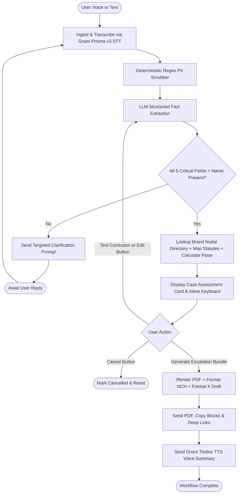
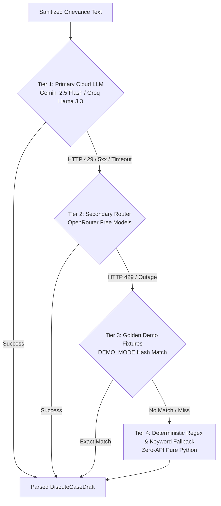

# ConsumerDost (उपभोक्ता दोस्त) — AI-Powered Voice Consumer Rights & Pre-Litigation Dispute Engine

**Product Requirements Document (PRD)**  
**Version:** 2.0 (CTO-Approved Build Specification for Hackathon MVP)  
**Prepared:** 3 November 2026  
**Primary Interface:** Telegram Bot (`aiogram 3.x`)  
**Target Market:** India (Voice input in Hindi, Hinglish, English; Formal English Legal Output + Hindi/English Audio Summary)  
**Architecture Pattern:** Deterministic Legal/Math Core + Gnani Speech APIs + LangGraph Stateful Workflow  

---

## 0. Instructions to the AI Engineering Agent

You are the engineering agent responsible for turning this PRD into a working, testable hackathon product. Treat this document as the single source of truth; do not silently remove requirements, invent fictitious Indian statutes, fabricate case citations, or replace missing integrations with ungrounded strings.

### Mandatory Implementation Rules

1. **Build a Working Vertical Slice First:** A user must be able to submit a consumer grievance via Telegram voice note or text, resolve missing critical facts (Complainant Full Name, Brand Name, Order/Transaction ID, Amount Paid, Incident Date), receive a deterministic case assessment grounded in the **Consumer Protection Act, 2019 (CPA 2019)**, and generate a complete, downloadable **Tri-Fold Escalation Dossier** (Formal Legal Notice PDF, National Consumer Helpline 1915 submission block, and X/Twitter escalation post) in a single action.
2. **Gnani.ai Platform Track Selection ([https://docs.gnani.ai/llms.txt](https://docs.gnani.ai/llms.txt)):** Gnani.ai provides three distinct developer products:
   - **Gnani AI Speech APIs ([https://docs.gnani.ai/api/introduction/introduction.md](https://docs.gnani.ai/api/introduction/introduction.md)):** REST, streaming, and batch APIs for Speech-to-Text (STT) and Text-to-Speech (TTS). **Use this track for P0** because ConsumerDost requires a custom, deterministic LangGraph pipeline for statutory mapping, integer-paise financial math, and PDF generation.
   - **Gnani AI Agents ([https://docs.gnani.ai/introduction.md](https://docs.gnani.ai/introduction.md)) & Agent Builder Platform APIs ([https://docs.gnani.ai/Platform/platform-introduction.md](https://docs.gnani.ai/Platform/platform-introduction.md)):** Hosted conversational agent console and REST APIs for managing agents, FAQs, and chat widgets. Do not offload core legal evaluation or damage math to the hosted Agent Builder in P0; reserve the Agent Builder Platform API for P2 web-widget FAQ syndication.
3. **Hybrid Voice-Narrative + Text-Identifier UX:** Use Gnani Prisma v3.0 STT to transcribe emotional, colloquial voice narratives in Hindi, Hinglish, and English. **Never rely solely on voice transcription for high-entropy alphanumeric identifiers** (Order ID, PNR, UPI UTR); if an identifier is missing or low-confidence, explicitly prompt the user to type or paste it via text. Use Gnani Timbre TTS to deliver a 15-second voice action summary at the end of the workflow.
4. **Enforce Self-Representation Disclaimers (No Unauthorized Practice of Law):** ConsumerDost is a pre-litigation self-representation drafting tool, not a licensed law firm or advocate. Under Section 35 of the Consumer Protection Act, 2019, Indian consumers have the statutory right to represent themselves without an advocate. Every generated artifact must carry a prominent self-representation disclaimer.
5. **Strict Deterministic Legal Grounding:** The LLM must never select or invent statutory sections. All legal citations must come from an immutable Python lookup dictionary (`STATUTE_REGISTRY`) mapping `{category, issue_type}` to verified provisions:
   - **Section 2(10) of CPA 2019:** Defect in Goods.
   - **Section 2(11) of CPA 2019:** Deficiency in Service.
   - **Section 2(47) of CPA 2019:** Unfair Trade Practice.
   - **Consumer Protection (E-Commerce) Rules, 2020:** Mandatory Grievance Officer appointment and 48-hour acknowledgement.
   - **CCPA Dark Patterns Guidelines (2023):** Drip pricing, forced bundling, false urgency, and basket sneaking.
   - **Sectoral Mandates:** DGCA Passenger Charter (CAR Section 3, Series M, Part IV), RBI Digital Payment TAT Harmonisation Circular (RBI/2019-20/67), and TRAI QoS Regulations.
6. **Pre-LLM Deterministic PII Scrubber:** Never ask for, store, or transmit banking passwords, UPI PINs, credit/debit card CVVs, 16-digit card numbers, or 12-digit government ID numbers. Run a deterministic regex sanitizer (`scrub_sensitive_pii()`) on every text message and STT transcript before saving to SQLite or calling the LLM API.
7. **Unicode-Safe PDF Generation:** Use `reportlab` with bundled TrueType fonts (`NotoSans-Regular.ttf` and `NotoSans-Bold.ttf`) registered via `pdfmetrics`. Never rely on default Helvetica (`WinAnsiEncoding`), which renders the Indian Rupee symbol (₹, U+20B9) as a black box (■). Draft all Legal Notices in formal English (the operating language of corporate Nodal Officers and Consumer Commissions) regardless of the user's input language.
8. **SQLite WAL Mode & Integer Paise Arithmetic:** Use local SQLite with Write-Ahead Logging (`PRAGMA journal_mode = WAL;`) for all user sessions, dispute records, brand directories, and LangGraph checkpoints—do not introduce Redis, PostgreSQL, Celery, or Docker dependencies. Store all monetary values in integer paise (`INTEGER`) and execute all calculations using Python `Decimal`.
9. **Timezones & Provenance:** Use `Asia/Kolkata` (IST) for all user-facing dates and relative date parsing (e.g., "kal", "pichle somwar"), store internal timestamps in UTC ISO-8601, and store incident dates as `YYYY-MM-DD`.
10. **Follow the Build Phases in Section 12:** Write deterministic domain unit tests (calculator, statute mapper, PII scrubber, brand lookup, PDF renderer) before wiring external Telegram and Gnani HTTP clients.
11. **4-Tier Zero-Cost & Demo-Safe LLM Architecture:** The LLM extraction and narrative synthesis pipeline must implement an automatic 4-tier cascading failover mechanism (Tier 1: Primary Free Cloud LLM -> Tier 2: Secondary Free Cloud Router -> Tier 3: Golden Demo Fixture Cache -> Tier 4: Deterministic Regex & Keyword Fallback) to guarantee 100% demo uptime with zero cost and zero runtime failure risk.

---

# 1. Problem Statement & Product Positioning

## 1.1 The Problem

Millions of Indian consumers lose money daily to unresolved micro- and mid-sized disputes across five high-frequency sectors:

- **E-Commerce & Retail:** Damaged, counterfeit, or missing products delivered; returns rejected under arbitrary seller policies.
- **Quick-Commerce & Food Delivery:** Expired/spoiled items, missing items, and automated chatbot refund denials.
- **Airlines & Travel:** Last-minute flight cancellations, denied boarding, or withheld refunds in violation of the DGCA Passenger Charter.
- **Telecom & Broadband:** Unsolicited value-added services (VAS), wrongful billing, and unlawful MNP porting rejections.
- **Digital Payments & UPI:** Failed UPI debits where money is deducted from the consumer's bank account but not reversed within the mandatory RBI T+1 turnaround window.

### Why 95% of Indian consumers abandon valid claims under ₹25,000:
1. **Tier-1 Chatbot Stonewalling:** Corporate support bots trap users in scripted loops (*"Our internal investigation is complete; we cannot process a refund"*) while hiding escalation paths to the company's statutory Nodal Grievance Officer.
2. **Linguistic & Regulatory Asymmetry:** Most citizens cannot draft a formal English Legal Demand Notice citing specific provisions of CPA 2019 or RBI/DGCA circulars.
3. **Prohibitive Legal Costs:** Paying a lawyer ₹3,000–₹10,000 to draft a pre-litigation notice for a ₹1,500–₹15,000 loss is economically irrational.

## 1.2 Product Solution & Positioning

ConsumerDost is a voice-first Telegram pre-litigation copilot that turns a 30-second vernacular complaint (in Hindi, Hinglish, or English) plus an Order/Transaction ID into a legally grounded **Tri-Fold Escalation Dossier** in under 4 seconds:

1. **Formal Legal Demand Notice (PDF) + Copyable Nodal Email Template:** Addressed directly to the brand's statutory Nodal Grievance Officer and Registered Office with a 7-day compliance deadline.
2. **National Consumer Helpline (NCH 1915 / INGRAM) Dossier:** Structured plain-text block formatted for one-tap submission to the official NCH WhatsApp bot (`+91 8860005372`) or web portal (`consumerhelpline.gov.in`).
3. **Public Social Escalation Post (X / Twitter):** High-visibility post tagging the brand's escalation handle and government watchdogs (`@jagograhakjago`, `@DoCA_GoI`).

---

# 2. Target Users & Primary Scenarios

| Persona | Profile & Scenario | Primary Friction | ConsumerDost Output |
| :--- | :--- | :--- | :--- |
| **Rohan** (24, Tier-2 City) | Ordered a ₹14,999 phone on Flipkart; received a broken item; return rejected by support bot. | Doesn't know Flipkart's Nodal Officer email or how to write a legal notice. | Formal PDF Demand Notice citing Sec 2(10) & 2(47) of CPA 2019 + Nodal Officer email copy block. |
| **Sunita** (46, Bhopal) | ₹1,200 UPI bill payment debited from bank; recharge failed; stuck for 6 days. | Speaks Hindi; cannot write formal English complaints; unaware of RBI ₹100/day penalty rule. | Speaks in Hindi, pastes 12-digit UTR, gets RBI-grounded notice demanding ₹1,200 + ₹500 statutory penalty + Hindi voice guide. |
| **Vikram** (32, Bengaluru) | Domestic flight cancelled 3 hours before departure; airline forces credit shell instead of refund. | Unaware of DGCA CAR Section 3, Series M, Part IV cash refund and compensation slabs. | Instant X escalation link + Legal Notice demanding 100% cash refund + ₹5,000 DGCA compensation. |

---

# 3. Scope, Non-Goals & Success Metrics

## 3.1 MVP Scope (P0 — Must Ship)

- **Telegram Bot Interface (`aiogram 3.x`):** Accepts voice notes (`.ogg`/`.oga`, up to 60 seconds, ≤ 20 MB) and text messages in Hindi, Hinglish, and English.
- **Gnani Speech APIs Integration:** Transcription via Gnani Prisma v3.0 REST STT (`indic-auto` / `hi-IN`) and 15-second closing audio summary via Gnani Timbre REST TTS, with automatic text fallback if API credentials fail or timeout (> 5.0 seconds).
- **Pre-LLM PII Sanitizer:** Deterministic regex scrubbing of 12-digit government IDs, 16-digit card numbers, CVVs, and PINs prior to persistence or LLM calls.
- **Hybrid Fact & Identity Extraction:** LLM extracts narrative facts while deterministic gates verify the presence of 5 mandatory fields: Brand, Order/Txn ID, Amount Paid, Incident Date, and Complainant Full Name.
- **Brand Nodal Directory:** Local curated JSON/SQLite directory of India's top 50 consumer brands across E-commerce, Quick-Commerce, Airlines, Telecom, and UPI/Fintech with RapidFuzz matching.
- **Deterministic Legal & Proportional Claim Engine:** Maps disputes to CPA 2019 and sectoral rules; computes Principal + 9% p.a. Equitable Interest + Regulatory Penalty (RBI/DGCA) + Tiered Harassment Damages in integer paise.
- **Single-Tap Tri-Fold Bundle Delivery:** Generates the Unicode-safe Legal Notice PDF, NCH 1915 dossier (with `wa.me/918860005372` deep link), X escalation post (with `twitter.com/intent/tweet` deep link), and Gnani TTS voice summary in one atomic flow.

## 3.2 Stretch Goals (P1 / P2)

- **P1 — Invoice & Screenshot OCR:** Extract Order IDs, dates, and amounts directly from uploaded invoice PDFs or WhatsApp screenshots.
- **P1 — Expanded Brand Directory:** Scale from 50 to 200+ brands including regional couriers and state electricity boards.
- **P2 — Gnani Agent Builder Platform API Integration:** Use the Gnani Agent Builder Platform APIs ([https://docs.gnani.ai/Platform/platform-introduction.md](https://docs.gnani.ai/Platform/platform-introduction.md)) to programmatically sync ConsumerDost's statutory FAQ knowledge base and deploy an embeddable web voice/chat widget alongside Telegram.
- **P2 — e-Daakhil Court Filing Kit:** Generate formatted consumer complaint petitions, notarizable affidavits, and index of documents for District Commission (DCDRC) filing if the 7-day notice expires unresolved.

## 3.3 Explicit Non-Goals (Out of Scope)

- **No Legal Representation:** Does not act as an advocate or law firm or guarantee court outcomes.
- **No Unauthorized Portal Scraping:** Does not auto-submit forms to `consumerhelpline.gov.in` or `edaakhil.nic.in` via browser automation.
- **No Sensitive Credential Storage:** Never collects or stores banking passwords, OTPs, UPI PINs, CVVs, or 12-digit government ID numbers.
- **No Non-Consumer Matters:** Rejects criminal complaints, matrimonial disputes, employment issues, property litigation, and B2B commercial disputes.

## 3.4 Verification & Success Metrics

| Metric | Target | Verification Method |
| :--- | :--- | :--- |
| **Voice STT + Extraction Accuracy** | ≥ 92% field match | Pytest evaluation across 10 curated Hindi/Hinglish test audio fixtures. |
| **Brand Nodal Resolution Accuracy** | 100% | Exact + fuzzy matching tests against the 50-brand master directory. |
| **Hallucinated Legal Citations** | 0 | Static assertion verifying all output clauses exist in `STATUTE_REGISTRY`. |
| **PDF & Bundle Generation Latency** | < 3.5 seconds | Benchmark from tapping *Generate Escalation Bundle* to PDF delivery. |
| **PDF Unicode Integrity** | 100% | Automated `pypdf` extraction confirming ₹ symbol and zero ■ glyphs. |
| **PII Scrubber Recall** | 100% | Unit tests verifying redaction of 12-digit IDs, 16-digit cards, and PINs. |
| **Gnani API Outage Resilience** | 100% | `respx` fault-injection tests confirming seamless fallback to text mode. |

---

# 4. User Experience & Telegram Interaction Design

## 4.1 Bot Commands

| Command | Action |
| :--- | :--- |
| `/start` | Displays welcome message, legal self-representation disclaimer, privacy pledge, and 1-tap demo prompts. |
| `/newdispute` | Resets active workflow state and initiates a fresh consumer dispute assessment. |
| `/mycases` | Lists the user's past disputes with buttons to re-download generated Legal Notice PDFs. |
| `/language` | Toggles preferred response and TTS audio language (Hindi, Hinglish, English). |
| `/cancel` | Aborts the current in-progress dispute draft and clears temporary state. |
| `/privacy` | Shows data retention policy with a `[ Delete My Data ]` button to purge all user records from SQLite. |

## 4.2 Step-by-Step Conversational Workflow

### Step 1 — Grievance Input & PII Sanitization
The user sends a voice note (up to 60s) or text message describing their dispute:
> *"Bhaiya maine Flipkart se 14,999 ka phone mangaya tha 25 October ko. Box khola toh screen tooti hui thi. Customer care bol raha hai return nahi hoga."*

- **If voice:** The bot downloads the `.oga`/`.ogg` file via Telegram `getFile`, converts it in-memory to 16kHz mono `.wav` via `ffmpeg` (if required by endpoint configuration), calls Gnani Prisma v3.0 STT, and deletes the temporary audio file immediately.
- The raw transcript passes through `scrub_sensitive_pii()` before being saved or echoed back to the user.

### Step 2 — Structured Fact Extraction
The LLM parser extracts structured entities into `DisputeCaseDraft`:
```json
{
  "brand_raw": "Flipkart",
  "category": "E_COMMERCE",
  "issue_type": "DEFECTIVE_GOODS_REFUND_DENIED",
  "product_name": "Smartphone",
  "order_id": null,
  "incident_date": "2026-10-25",
  "amount_paid_inr": 14999.00,
  "complainant_full_name": null,
  "complainant_contact": null,
  "incident_summary": "Smartphone delivered with broken screen on 25 Oct 2026; Flipkart support refused return/refund.",
  "missing_critical_fields": ["order_id", "complainant_full_name", "complainant_contact"]
}
```

### Step 3 — Hybrid Text Clarification for Identifiers & Identity
Because voice STT is unreliable for alphanumeric codes and Telegram display names are often pseudonyms, if any critical field (`brand_raw`, `amount_paid_inr`, `incident_date`, `order_id`, `complainant_full_name`, `complainant_contact`) is missing, the bot asks a single consolidated clarification prompt:

> *"Voice complaint recorded (₹14,999 Flipkart Smartphone, 25 Oct 2026). To generate your official Legal Notice, please type or paste:*\
> *1. Your exact Order ID / Transaction No.*\
> *2. Your Full Legal Name and Email/Mobile (as Sender on the notice)"*
>
> *(Note: Once `complainant_full_name` and `complainant_contact` are provided once, they are cached in the `users` table for future disputes.)*

### Step 4 — Brand Nodal Resolution & Deterministic Calculation
- **Brand Lookup:** Matches `Flipkart` against `brand_directory` → resolves *Flipkart Internet Private Limited*, Registered Office Address (Bengaluru), Nodal Grievance Email (`grievance.officer@flipkart.com`), and X handle (`@FlipkartSupport`).
- **Statutory Mapping & Math:** Maps `E_COMMERCE` + `DEFECTIVE_GOODS_REFUND_DENIED` to Sections 2(10), 2(11), and 2(47) of CPA 2019 and E-Commerce Rules, 2020.
- **Calculates:**
  - Principal Refund: ₹14,999.00 (1499900 paise)
  - Equitable Interest (9% p.a. for 9 days): ₹33.28 (3328 paise)
  - Tiered Harassment & Mental Agony Damages: ₹5,000.00 (500000 paise)
  - Total Demand: ₹20,032.28 (2003228 paise)

### Step 5 — Interactive Case Confirmation Card
The bot sends a consolidated summary card with an inline keyboard:

```text
Pre-Litigation Assessment Ready
Complainant: Rohan Sharma (rohan@email.com)
Corporate Entity: Flipkart Internet Private Limited
Nodal Officer Email: grievance.officer@flipkart.com
Order ID: OD3091823901 | Date: 2026-10-25
Applicable Law: Sec 2(10), 2(11) & 2(47) of CPA 2019; E-Commerce Rules 2020
Total Claim: ₹20,032.28 (Principal ₹14,999.00 + 9% Interest ₹33.28 + Damages ₹5,000.00)
Compliance Deadline: 7 Calendar Days

Inline Buttons:
[ Generate Full Escalation Bundle ]
[ Edit Details ]  [ Cancel ]
```

If the user taps `[ Edit Details ]` or types a correction message (e.g., *"Change amount to 15499"*), the graph merges the update and refreshes the confirmation card without restarting the conversation.

### Step 6 — Atomic Tri-Fold Bundle & Voice Delivery
When the user taps `[ Generate Full Escalation Bundle ]`, the bot executes all three generators and delivers:

1. **Document 1 (Telegram File Attachment):** `Legal_Notice_Flipkart_OD3091823901.pdf` accompanied by copy-ready triple-backtick blocks containing the Nodal Officer's email address, email subject line, and formal cover email body.
2. **Document 2 (NCH 1915 Dossier Message):** Copy-ready plain-text complaint block formatted for the National Consumer Helpline plus a one-tap `[ Open NCH WhatsApp (8860005372) ]` URL button ([https://wa.me/918860005372](https://wa.me/918860005372)).
3. **Document 3 (X / Twitter Escalation Message):** Copy-ready <280 character post tagging `@FlipkartSupport`, `@jagograhakjago`, and `@DoCA_GoI` plus a one-tap `[ Post on X ]` URL button (`https://twitter.com/intent/tweet?text=...`).
4. **Document 4 (Gnani Timbre Voice Note):** A 15-second Hindi/English voice note explaining how to send the email, paste the NCH text on WhatsApp, and post the tweet.

---

# 5. Functional Requirements

- **FR-01: Onboarding, Session Idempotency & Privacy (P0):** `/start` registers the user in `users`, displays the legal disclaimer, and deduplicates Telegram webhook/polling updates via `processed_updates`. `/privacy` allows immediate hard-deletion of all user rows across `dispute_cases` and `generated_artifacts`.
- **FR-02: Pre-LLM Deterministic PII Scrubber (P0):** Before logging, storing, or sending any user text/transcript to the LLM, `scrub_sensitive_pii(text)` must redact:
  - 12-digit numeric sequences matching government ID patterns (`\b\d{4}[\s-]?\d{4}[\s-]?\d{4}\b` when not prefixed by UTR/Order/Ref) → `[REDACTED_GOVT_ID]`.
  - 16-digit payment card numbers (`\b(?:\d[ -]*?){16}\b`) → `[REDACTED_CARD]`.
  - Explicit PIN/CVV/OTP disclosures (e.g., *PIN is 1234*, *CVV 889*) → `[REDACTED_SECRET]`.
- **FR-03: Voice Grievance Processing via Gnani Prisma v3.0 (P0):** Accept `.ogg`/`.oga` voice notes up to 60 seconds; reject longer clips with a friendly prompt. Call `POST https://api.vachana.ai/stt/v3` with `httpx.AsyncClient(timeout=5.0)`, delete local temp files inside a `finally` block, and gracefully fall back to text input if the API fails or returns HTTP 4xx/5xx.
- **FR-04: Hybrid Intent & Fact Extraction (P0):** Use structured LLM output (`DisputeCaseDraft`) to extract narrative facts, category, amount, relative dates (resolved against `Asia/Kolkata`), and identifiers. If the input came from voice and `order_id` looks like phonetic words rather than a valid code, set `order_id = None` so the bot prompts the user to type/paste it.
- **FR-05: Curated 50-Brand Nodal Directory (P0):** Maintain `data/brands.json` seeded into SQLite `brand_directory` covering the top 50 Indian brands across the 5 MVP categories. Resolve brand queries via exact alias match followed by `rapidfuzz.process.extractOne` (threshold ≥ 85). If a brand is unlisted, prompt the user for the brand name and support email and use the Generic Corporate Notice template.
- **FR-06: Deterministic Legal Grounding & Financial Calculator (P0):** Map `{category, issue_type}` strictly via `STATUTE_REGISTRY`. Compute principal, 9% p.a. equitable interest, regulatory penalties (RBI ₹100/day beyond T+1; DGCA slabs), and tiered mental agony damages using `Decimal` and store in integer paise.
- **FR-07: Unicode-Safe Legal Demand Notice PDF Engine (P0):** Render a formal 1–2 page A4 PDF using `reportlab` with registered `NotoSans-Regular.ttf` and `NotoSans-Bold.ttf` fonts so ₹ renders cleanly. Include reference number, notice date, Nodal Officer & Registered Office addressee block, Complainant name & contact block, chronological facts, statutory violations, itemized financial demand table, 7-day compliance window, Section 35 DCDRC litigation warning, and footer disclaimer.
- **FR-08: NCH 1915 & Social Escalation Formatters (P0):** Generate plain-text NCH submission blocks (< 2,000 chars) with `wa.me/918860005372` deep link and < 280 char X posts with `twitter.com/intent/tweet` URL encoding.
- **FR-09: Gnani Timbre TTS Voice Summary (P0):** Synthesize a 15–20 second action summary via `POST https://api.vachana.ai/api/v1/tts/inference` in the user's preferred language (`hi-IN` or `en-IN`). If TTS fails or times out, skip the voice note without failing the bundle delivery.
- **FR-10: Offline DEMO_MODE Fixtures (P0):** When `DEMO_MODE=true` and external Gnani keys are absent or unreachable, serve deterministic transcripts and pre-generated TTS audio for bundled sample voice notes and stamp the PDF header with *"HACKATHON DEMO SPECIMEN"*.

---

# 6. Deterministic Legal Grounding & Financial Arithmetic

## 6.1 Statutory Mapping Registry (`src/consumerdost/domain/statutes.py`)

| Dispute Category & Issue Type | Primary CPA 2019 Sections | Sectoral Rules & Circulars | Standard Notice Relief Demanded |
| :--- | :--- | :--- | :--- |
| **`ECOMMERCE_DEFECTIVE_GOODS`** | Sec 2(10) (Defect), Sec 2(47) (Unfair Trade Practice) | Consumer Protection (E-Commerce) Rules 2020; Sale of Goods Act 1930 (Sec 15/16) | 100% Refund + 9% p.a. Interest + Tiered Damages |
| **`ECOMMERCE_REFUND_DELAY_OR_DENIAL`** | Sec 2(11) (Deficiency), Sec 2(47) (Unfair Trade Practice) | E-Commerce Rules 2020 (Rule 4 & 5 Grievance Redressal) | Immediate Refund + 9% p.a. Interest + Tiered Damages |
| **`QCOMM_EXPIRED_OR_MISSING_ITEMS`** | Sec 2(10) (Defect), Sec 2(11) (Deficiency) | Food Safety and Standards Act 2006 (for spoiled food items) | 100% Order Refund + Tiered Damages |
| **`DARK_PATTERNS_HIDDEN_FEES`** | Sec 2(47) (Unfair Trade Practice), Sec 18 (CCPA Powers) | CCPA Guidelines for Prevention and Regulation of Dark Patterns, 2023 | Reversal of Drip Pricing / Forced Add-On Charges + Damages |
| **`UPI_FAILED_DEBIT_STUCK`** | Sec 2(11) (Deficiency in Service) | RBI Circular RBI/2019-20/67 (DPSS.CO.PD No.629) on TAT Harmonisation | Principal Reversal + ₹100/day Mandatory Penalty beyond T+1 + Damages |
| **`AIRLINE_CANCELLED_OR_DELAYED`** | Sec 2(11) (Deficiency in Service) | DGCA CAR Section 3, Series M, Part IV (Passenger Charter) | 100% Cash Refund + ₹5,000–₹10,000 DGCA Statutory Compensation |
| **`TELECOM_WRONGFUL_BILLING_OR_VAS`** | Sec 2(11) (Deficiency), Sec 2(47) (Unfair Trade Practice) | TRAI Quality of Service (QoS) Regulations | Full Reversal of Unauthorized Charges + Tiered Damages |

## 6.2 Proportional Financial Calculator (`src/consumerdost/domain/calculator.py`)

To prevent frivolous or disproportionate claims on small transactions, all demands are calculated deterministically in integer paise (1 INR = 100 paise):

1. **Principal Claim (`principal_paise`):**
   $$\text{principal\_paise} = \text{round}(\text{amount\_paid\_inr} \times 100)$$

2. **Equitable Interest (`interest_paise`):** 9% per annum from `incident_date` to `notice_date` (minimum 1 day):
   $$\text{interest\_paise} = \text{round}\left(\text{principal\_paise} \times \frac{9}{100} \times \frac{\max(1, \text{days\_elapsed})}{365}\right)$$

3. **Sectoral Statutory Penalty (`statutory_penalty_paise`):**
   - If `issue_type == "UPI_FAILED_DEBIT_STUCK"`:
     $$\max(0, \text{days\_elapsed} - 1) \times 10000 \text{ paise} \quad (\text{₹100/day after T+1 per RBI circular})$$
   - If `issue_type == "AIRLINE_CANCELLED_OR_DELAYED"`:
     $$500000 \text{ paise} \quad (\text{₹5,000 baseline DGCA compensation slab})$$
   - Otherwise: `0`

4. **Tiered Harassment & Mental Agony Damages (`damages_paise`):**
   - Principal $< ₹500 \rightarrow ₹500$ (50000 paise)
   - Principal $₹500 \text{ to } ₹4,999.99 \rightarrow ₹1,500$ (150000 paise)
   - Principal $₹5,000 \text{ to } ₹24,999.99 \rightarrow ₹5,000$ (500000 paise)
   - Principal $\ge ₹25,000 \rightarrow ₹10,000$ (1000000 paise)

5. **Total Demand (`total_demanded_paise`):**
   $$\text{total\_demanded\_paise} = \text{principal\_paise} + \text{interest\_paise} + \text{statutory\_penalty\_paise} + \text{damages\_paise}$$

---

# 7. LangGraph Agent Architecture & State Schema

## 7.1 Workflow Graph (`src/consumerdost/agent/graph.py`)



## 7.2 Graph State Definition (`src/consumerdost/agent/state.py`)

```python
from typing import TypedDict

class BrandInfo(TypedDict):
    canonical_name: str
    corporate_name: str
    registered_address: str
    nodal_officer_name: str | None
    nodal_email: str
    twitter_handle: str | None
    category: str

class ConsumerDostState(TypedDict):
    telegram_user_id: str
    chat_id: str
    thread_id: str
    preferred_language: str              # 'hi-IN', 'hinglish', or 'en-IN'
    raw_input_text: str | None
    voice_file_id: str | None
    sanitized_transcript: str | None
    complainant_full_name: str | None    # Required for Legal Notice Sender block
    complainant_contact: str | None      # Email or phone for Brand reply
    brand_raw: str | None
    brand_resolved: BrandInfo | None
    order_id: str | None
    incident_date: str | None            # ISO YYYY-MM-DD
    amount_paid_inr: float | None
    dispute_category: str | None
    issue_type: str | None
    dispute_narrative_en: str | None     # Formal English statement of facts
    communication_summary: str | None
    missing_fields: list[str]
    clarification_prompt: str | None
    legal_clauses: list[str]
    principal_paise: int
    calculated_interest_paise: int
    statutory_penalty_paise: int
    damages_claimed_paise: int
    total_claim_paise: int
    case_reference_id: str | None        # e.g., CD-2026-0042
    pdf_file_path: str | None
    nch_dossier_text: str | None
    twitter_draft_text: str | None
    tts_audio_path: str | None
    status: str                          # DRAFT, AWAITING_CONFIRMATION, GENERATED, CANCELLED
```

## 7.3 The 4-Tier Zero-Cost & Demo-Safe Strategy

To guarantee that ConsumerDost never fails during a live hackathon presentation or evaluation due to API rate limits, expired keys, venue Wi-Fi drops, or vendor outages, the system implements an automatic 4-tier cascading fallback router:



1. **Tier 1 — Primary Free Cloud LLM (Gemini Free Tier or Groq Free Tier):**
   - **Google AI Studio (`gemini-2.5-flash`):** Free of charge via `aistudio.google.com` (up to 15 RPM / 1,500 requests per day—more than enough for a hackathon).
   - **Groq Cloud (`llama-3.3-70b-versatile`):** Free API key at `console.groq.com` with sub-500ms structured JSON output and generous daily free limits.
2. **Tier 2 — Secondary Free Cloud Router (OpenRouter Free Models):**
   - **OpenRouter (`openrouter.ai`):** Gives access to `:free` endpoints (such as `meta-llama/llama-3.3-70b-instruct:free` or `google/gemini-2.0-flash-exp:free`) using an OpenAI-compatible SDK with zero credit card required.
3. **Tier 3 — Golden Demo Fixture Cache (`DEMO_MODE=true`):**
   - If the user sends one of the rehearsed demo prompts (or voice notes), a fast keyword/hash check matches it against pre-verified JSON fixtures so the live pitch executes in < 50ms even if venue Wi-Fi dies completely.
4. **Tier 4 — Deterministic Regex & Keyword Fallback (Zero-API Catch-All):**
   - If a judge tests a brand-new prompt when all API keys are missing, expired, or HTTP 429 rate-limited, a pure-Python regex parser extracts:
     - **Brand:** via RapidFuzz against `brands.json` (threshold >= 80).
     - **Amount:** via currency regex pattern (`₹`, `rs`, `rupees`, `ka`).
     - **Order ID / Reference:** alphanumeric token regex (`OD\d+`, `\b\d{12}\b` UTR, or standalone alphanumeric strings).
     - **Category & Issue Type:** Hinglish keyword dictionary (e.g., "toota", "damaged", "return", "refund", "flight", "recharge", "debit").
     - **Incident Date:** relative date parser (`kal`, `yesterday`, or explicit date).
     - **Narrative Synthesis:** Constructs a clean formal English statement of facts using a deterministic legal template without invoking any external API.

---

# 8. Technical Stack & SQLite Data Model

## 8.1 Technology Stack

| Component | Package / Choice | Purpose |
| :--- | :--- | :--- |
| **Language & Runtime** | Python 3.12+ | Async execution, strict TypedDict and Decimal support. |
| **Telegram Framework** | `aiogram >= 3.10` | Async Bot API polling/webhook router and inline keyboard state handling. |
| **Speech Pipeline** | Gnani AI Speech APIs (Prisma v3 STT + Timbre TTS) | Indic/Hinglish voice transcription and voice note synthesis over REST. |
| **Agent Orchestration** | `langgraph` + `langgraph-checkpoint-sqlite` | Stateful conversation graph persisted directly in local SQLite. |
| **LLM Extraction** | 4-Tier Router (`google-genai` / `groq` / `openrouter` / `regex_fallback`) | 4-tier zero-cost resilient extraction with deterministic offline fallback. |
| **Fuzzy Matching** | `rapidfuzz` | Sub-millisecond brand alias resolution against the 50-brand directory. |
| **PDF Engine** | `reportlab` + NotoSans TTF | Deterministic A4 legal notice generation with native ₹ glyph support. |
| **Database** | SQLite 3 + `aiosqlite` + `SQLAlchemy 2.0` | Zero-config relational persistence running in WAL mode. |
| **Testing** | `pytest` + `pytest-asyncio` + `respx` + `pypdf` | Deterministic unit, HTTP mock, and PDF text-verification tests. |

## 8.2 SQLite Schema (`src/consumerdost/database/models.py`)

Execute `PRAGMA journal_mode = WAL; PRAGMA foreign_keys = ON;` on every connection initialization:

### `users`
- `id` INTEGER PRIMARY KEY AUTOINCREMENT
- `telegram_user_id` TEXT UNIQUE NOT NULL
- `telegram_chat_id` TEXT NOT NULL
- `legal_full_name` TEXT NULL
- `contact_detail` TEXT NULL
- `preferred_language` TEXT NOT NULL DEFAULT 'hi-IN'
- `created_at` TEXT NOT NULL, `updated_at` TEXT NOT NULL

### `processed_updates`
- `update_id` TEXT PRIMARY KEY
- `telegram_user_id` TEXT NOT NULL
- `processed_at` TEXT NOT NULL

### `brand_directory`
- `id` INTEGER PRIMARY KEY AUTOINCREMENT
- `canonical_name` TEXT UNIQUE NOT NULL
- `aliases_json` TEXT NOT NULL
- `corporate_name` TEXT NOT NULL
- `registered_address` TEXT NOT NULL
- `nodal_officer_name` TEXT NULL
- `nodal_email` TEXT NOT NULL
- `twitter_handle` TEXT NULL
- `category` TEXT NOT NULL

### `dispute_cases`
- `id` TEXT PRIMARY KEY (`CD-YYYY-XXXX`)
- `telegram_user_id` TEXT NOT NULL
- `complainant_name` TEXT NOT NULL
- `complainant_contact` TEXT NOT NULL
- `brand_name` TEXT NOT NULL
- `brand_corporate_name` TEXT NOT NULL
- `registered_address` TEXT NOT NULL
- `nodal_email` TEXT NOT NULL
- `order_id` TEXT NOT NULL
- `incident_date` TEXT NOT NULL (`YYYY-MM-DD`)
- `category` TEXT NOT NULL, `issue_type` TEXT NOT NULL
- `principal_paise` INTEGER NOT NULL
- `interest_paise` INTEGER NOT NULL DEFAULT 0
- `statutory_penalty_paise` INTEGER NOT NULL DEFAULT 0
- `damages_demanded_paise` INTEGER NOT NULL DEFAULT 0
- `total_demanded_paise` INTEGER NOT NULL
- `narrative_facts_en` TEXT NOT NULL
- `legal_clauses_json` TEXT NOT NULL
- `status` TEXT NOT NULL (`DRAFT`, `ASSESSED`, `BUNDLE_GENERATED`, `RESOLVED`, `CANCELLED`)
- `created_at` TEXT NOT NULL, `updated_at` TEXT NOT NULL

### `generated_artifacts`
- `id` TEXT PRIMARY KEY (UUID)
- `dispute_case_id` TEXT NOT NULL REFERENCES `dispute_cases(id)` ON DELETE CASCADE
- `artifact_type` TEXT NOT NULL (`LEGAL_NOTICE_PDF`, `NCH_DOSSIER`, `TWITTER_DRAFT`, `TTS_SUMMARY`)
- `file_path` TEXT NULL
- `content_text` TEXT NULL
- `created_at` TEXT NOT NULL

---

# 9. External API Contracts (Gnani AI Speech APIs)

*Reference: Discover full endpoint specifications via the Gnani.ai Documentation Index ([https://docs.gnani.ai/llms.txt](https://docs.gnani.ai/llms.txt)) under Gnani AI APIs ([https://docs.gnani.ai/api/introduction/introduction.md](https://docs.gnani.ai/api/introduction/introduction.md)).*

## 9.1 Gnani Prisma v3.0 REST STT (`src/consumerdost/speech/gnani_stt.py`)

- **Endpoint:** `POST https://api.vachana.ai/stt/v3` (configurable via `GNANI_STT_URL`)
- **Headers:** `X-API-Key-ID: <GNANI_API_KEY_ID>`
- **Audio Normalization:** Telegram sends voice notes as `.oga` (Opus in Ogg). If `ffmpeg` is available on `PATH`, convert `.oga` to 16kHz 16-bit mono PCM `.wav` in a temporary file before upload; otherwise upload `.ogg` directly.
- **Multipart Form Fields:**
  - `audio_file`: binary audio stream
  - `model`: `prisma-v3.0`
  - `language_code`: `indic-auto` (or user's selected `hi-IN` / `en-IN`)
- **Expected Response:**
```json
{
  "transcript": "Maine Flipkart se 14999 ka phone mangaya tha box me toota phone nikla...",
  "detected_language": "hi-IN",
  "confidence": 0.94
}
```

## 9.2 Gnani Timbre REST TTS (`src/consumerdost/speech/gnani_tts.py`)

- **Endpoint:** `POST https://api.vachana.ai/api/v1/tts/inference` (configurable via `GNANI_TTS_URL`)
- **Headers:** `X-API-Key-ID: <GNANI_API_KEY_ID>`, `Content-Type: application/json`
- **JSON Request Payload:**
```json
{
  "text": "Aapka legal notice aur complaint package taiyaar hai. Step 1: PDF notice ko Flipkart ke Nodal Officer ko email karein. Step 2: National Consumer Helpline WhatsApp par complaint paste karein. Step 3: Agar 48 ghante mein jawab na aaye toh X par tweet post karein.",
  "language_code": "hi-IN",
  "audio_format": "mp3"
}
```

---

# 10. Error Handling & Edge-Case Recovery Matrix

| Failure Mode | System Action | User-Facing Message |
| :--- | :--- | :--- |
| **Voice note > 60 seconds or > 20 MB** | Reject prior to download. | *"Voice note is over 60 seconds. Please send a shorter voice note or type your complaint."* |
| **Gnani STT 401/403/5xx or > 5.0s Timeout** | Log warning; switch turn to text fallback (or load fixture transcript if `DEMO_MODE=true` and hash matches). | *"Voice transcription is temporarily busy. Please type your grievance below and we will proceed immediately."* |
| **User shares Card Number, PIN, or 12-digit Govt ID** | `scrub_sensitive_pii()` replaces digits with `[REDACTED_*]` before DB/LLM. | *"For your security, sensitive card/ID/PIN numbers were automatically scrubbed. Only your Order/Transaction ID is needed."* |
| **Spoken Order ID / UTR is unintelligible** | Parser sets `order_id = None` and routes to `CLARIFY` node. | *"Please type or paste your exact Order ID / Transaction Reference Number so there are no typos in your Legal Notice."* |
| **Brand not in Top 50 Directory** | `rapidfuzz` score < 85; prompt user for brand's support email and use Generic Corporate template. | *"I couldn't find '[Brand]' in our verified directory. Please type their customer support/grievance email (or type 'skip' to generate a standard notice)."* |
| **All Cloud LLM APIs 429 / Outage / Offline** | Router automatically cascades from Tier 1 (Gemini/Groq) to Tier 2 (OpenRouter:free), then Tier 3 (Fixture hash match), then Tier 4 (Deterministic regex/keyword parser). | Seamlessly continues case extraction without raising error to the user. |
| **ReportLab PDF Render Exception** | Catch exception, log traceback, and send formatted plain-text Legal Notice in Telegram. | *"PDF rendering encountered an issue. Here is the complete text of your Legal Notice ready to copy and email:"* |

---

# 11. Repository Structure & Environment Configuration

## 11.1 Directory Layout

```text
consumerdost/
├── README.md
├── PRD.md
├── pyproject.toml
├── .env.example
├── .gitignore
├── assets/
│   └── fonts/
│       ├── NotoSans-Regular.ttf     # Bundled Unicode TTF for ₹ symbol rendering
│       └── NotoSans-Bold.ttf
├── data/
│   ├── brands.json                  # Curated top 50 Indian brands directory
│   └── fixtures/                    # Sample .ogg voice notes & golden JSON cases
├── scripts/
│   ├── init_db.py
│   └── seed_brands.py
├── src/
│   └── consumerdost/
│       ├── __init__.py
│       ├── main.py                  # Async entrypoint
│       ├── config.py                # Pydantic Settings
│       ├── logging_config.py
│       ├── security/
│       │   └── pii_scrubber.py      # Pre-LLM deterministic regex sanitizer
│       ├── telegram/
│       │   ├── bot.py               # aiogram Dispatcher & middleware
│       │   ├── handlers/
│       │   │   ├── start.py
│       │   │   ├── grievance.py
│       │   │   ├── callbacks.py
│       │   │   └── privacy.py
│       │   ├── keyboards.py
│       │   └── formatters.py
│       ├── speech/
│       │   ├── gnani_stt.py         # Gnani Prisma v3.0 REST client
│       │   └── gnani_tts.py         # Gnani Timbre REST client
│       ├── agent/
│       │   ├── graph.py             # LangGraph state machine
│       │   ├── state.py             # ConsumerDostState TypedDict
│       │   ├── nodes.py             # Ingest, scrub, parse, clarify, resolve, bundle
│       │   ├── prompts.py
│       │   ├── llm_router.py        # 4-tier cascading LLM fallback client
│       │   └── regex_fallback.py    # Zero-API deterministic pure-Python extractor
│       ├── domain/
│       │   ├── models.py            # Pydantic schemas
│       │   ├── statutes.py          # Immutable CPA 2019 & sectoral registry
│       │   ├── calculator.py        # Decimal/paise proportional claim engine
│       │   └── brands.py            # RapidFuzz brand lookup
│       ├── documents/
│       │   ├── pdf_generator.py     # ReportLab + NotoSans PDF renderer
│       │   ├── nch_formatter.py     # NCH 1915 dossier + WhatsApp link
│       │   └── social_formatter.py  # X escalation draft + intent URL
│       └── database/
│           ├── engine.py            # SQLite WAL engine setup
│           ├── models.py            # SQLAlchemy 2.0 tables
│           └── repository.py
└── tests/
    ├── unit/
    │   ├── test_pii_scrubber.py
    │   ├── test_calculator.py
    │   ├── test_statutes.py
    │   ├── test_brand_lookup.py
    │   ├── test_llm_router.py
    │   └── test_regex_fallback.py
    └── integration/
        ├── test_pdf_unicode.py
        ├── test_gnani_client.py
        └── test_agent_graph.py
```

## 11.2 `.env.example`

```dotenv
APP_ENV=development
APP_NAME=ConsumerDost
DEMO_MODE=true
TIMEZONE=Asia/Kolkata

# Telegram Bot Configuration
TELEGRAM_BOT_TOKEN=your_telegram_bot_token_here

# Gnani AI Speech APIs Configuration (https://docs.gnani.ai/llms.txt)
GNANI_API_KEY_ID=your_gnani_api_key_id_here
GNANI_STT_URL=https://api.vachana.ai/stt/v3
GNANI_TTS_URL=https://api.vachana.ai/api/v1/tts/inference

# 4-Tier Zero-Cost LLM Router Configuration
GEMINI_API_KEY=your_gemini_api_key_here
GROQ_API_KEY=your_groq_api_key_here
OPENROUTER_API_KEY=your_openrouter_api_key_here
PRIMARY_LLM_PROVIDER=gemini # 'gemini', 'groq', or 'openrouter'
LLM_MODEL=gemini-2.5-flash

# SQLite Database Configuration
DATABASE_URL=sqlite+aiosqlite:///data/consumerdost.db
```

---

# 12. Phased Implementation Plan (Follow Strictly in Order)

- **Phase 0 — Project Skeleton & Fonts:** Initialize `pyproject.toml` (`aiogram`, `langgraph`, `langgraph-checkpoint-sqlite`, `reportlab`, `rapidfuzz`, `httpx`, `pydantic`, `pydantic-settings`, `sqlalchemy`, `aiosqlite`, `google-genai`, `groq`, `pytest`, `pytest-asyncio`, `respx`, `pypdf`), `.env.example`, and bundle `NotoSans-Regular.ttf` / `NotoSans-Bold.ttf` in `assets/fonts/`.
- **Phase 1 — Deterministic Security, Domain Core & Zero-API Fallback:** Implement `pii_scrubber.py`, `statutes.py` (`STATUTE_REGISTRY`), `calculator.py` (integer paise + tiered damages + RBI/DGCA penalties), `brands.py` (`data/brands.json` with 50 Indian brands + RapidFuzz lookup), and `regex_fallback.py` (pure-Python regex & keyword parser). Run `pytest tests/unit/` until 100% green.
- **Phase 2 — Tri-Fold Document Engines:** Implement `pdf_generator.py` (registering NotoSans TTF so ₹ renders properly), `nch_formatter.py`, and `social_formatter.py`. Write `test_pdf_unicode.py` using `pypdf` to assert that generated PDFs contain ₹, the Nodal Officer's email, and the CPA 2019 self-representation disclaimer.
- **Phase 3 — SQLite WAL Persistence:** Implement `database/engine.py` (`PRAGMA journal_mode=WAL;`), `models.py`, and `repository.py`.
- **Phase 4 — Gnani Speech Clients:** Implement `gnani_stt.py` and `gnani_tts.py` with 5.0s timeouts, `DEMO_MODE` fixture fallback, and `respx` unit tests.
- **Phase 5 — 4-Tier LLM Router & LangGraph Workflow:** Implement `llm_router.py` (cascading Tier 1 Gemini/Groq -> Tier 2 OpenRouter -> Tier 3 Fixture Cache -> Tier 4 Regex Fallback), then wire `state.py`, `nodes.py`, and `graph.py` with `SqliteSaver` checkpointing, ensuring missing fields (`order_id`, `complainant_full_name`, `complainant_contact`) trigger the hybrid clarification prompt and inline edits merge cleanly.
- **Phase 6 — Telegram Bot & End-to-End Verification:** Connect `aiogram` handlers, update deduplication middleware, and inline callback buttons (`[ Generate Full Escalation Bundle ]`, `[ Edit Details ]`, `[ Cancel ]`), then run the full end-to-end integration test from sample Hindi voice note to downloadable PDF bundle.
