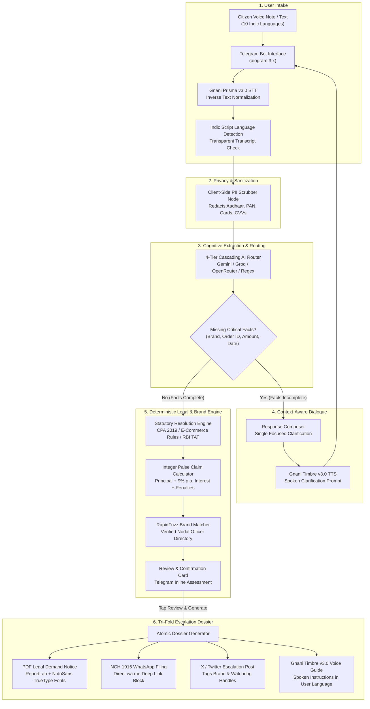

# SAARTHI

AI-Powered Voice Consumer Rights & Pre-Litigation Dispute Engine


Built for the **Gnani.ai Great Indian AI Internship Challenge** by **Ravi Ranjan Sharma** ([@codebysnorlax](https://github.com/codebysnorlax)).

---

## Key Links & Resources

- Video Demonstration: https://lnkd.in/p/dHtHE5Na
- X (Twitter) Announcement: https://x.com/codebysnorlax/status/2119890661541544103
- Telegram Bot: https://t.me/SaarthiHQBot
- Solution Pitch Document: [SOLUTION_PITCH.md](SOLUTION_PITCH.md)
- Cross-Platform Installation Guide: [INSTALLATION.md](INSTALLATION.md)
- GitHub Repository: https://github.com/codebysnorlax/Gnani

---

## Executive Summary & Solution Pitch

SAARTHI (pronounced *saar-thee*) is a sovereign, voice-first pre-litigation legal assistant that converts spoken consumer grievances in 10 Indic languages into formal, court-ready legal demand notices, National Consumer Helpline (NCH 1915) filings, and public escalation posts under the **Consumer Protection Act, 2019**, in under 4 minutes.

### The 25,000 INR Consumer Abyss
In India, over 95% of valid consumer disputes under 25,000 INR are abandoned. Everyday citizens face three systemic obstacles:
1. Corporate Chatbot Stonewalling: Customer support bots trap aggrieved consumers in scripted loops while concealing escalation paths to statutory Nodal Grievance Officers.
2. Linguistic and Regulatory Asymmetry: While grievances occur in vernacular languages, pre-litigation notices and Nodal Officer escalations require formal English legal citations under Indian statutes.
3. Prohibitive Legal Costs: Retaining an advocate to draft a pre-litigation notice costs between 3,000 and 10,000 INR, rendering formal legal action economically unviable for everyday consumer losses.

### The Sovereign Voice AI Solution
Under Section 35 of the Consumer Protection Act, 2019, Indian consumers possess the statutory right to represent themselves without an advocate. SAARTHI operationalizes this right by allowing any citizen to speak naturally in their mother tongue. Powered by **Gnani.ai Speech AI (Prisma v3.0 STT & Timbre v3.0 TTS)**, SAARTHI intakes voice narratives, clarifies missing facts through context-aware dialogue, applies deterministic legal math, and delivers a complete, downloadable **Tri-Fold Escalation Dossier**.

For an executive overview of the business model, regulatory foundation, and social impact, read the full [Solution Pitch Document (SOLUTION_PITCH.md)](SOLUTION_PITCH.md).

---

## Video Demonstration & Context

A complete video demonstration of SAARTHI is available on LinkedIn and X:

- Watch the Video Demo on LinkedIn: https://lnkd.in/p/dHtHE5Na
- View the Video Post on X: https://x.com/codebysnorlax/status/2119890661541544103

### Video Walkthrough Breakdown
The video demonstrates the complete user journey from voice intake to atomic legal dossier generation:
- 0:00 - Welcome & Language Selection: User starts the bot, views the welcome banner, and selects from 10 supported Indic languages via persistent reply keyboards.
- 0:45 - Vernacular Voice Note Intake: User records a 30-second conversational grievance in Hindi regarding a defective product and rejected return.
- 1:20 - Real-Time Transcription & PII Redaction: Gnani Prisma v3.0 STT transcribes the audio with Inverse Text Normalization (ITN), while the PII scrubber redacts sensitive payment card and Aadhaar numbers.
- 1:55 - Dynamic Slot Clarification: The Response Composer acknowledges established facts and prompts the user for missing details (Order ID and incident date) without repetitive questioning.
- 2:30 - Deterministic Case Assessment: The engine matches the brand against the verified corporate directory, maps violations under CPA 2019 Section 2(10) and Section 2(47), and computes principal plus statutory interest in integer paise.
- 3:00 - Tri-Fold Dossier Delivery: User reviews the case assessment card and taps to generate the PDF Legal Notice, NCH 1915 WhatsApp filing block, X escalation draft, and Gnani Timbre spoken audio guide.

---

## Core Capabilities

1. Voice-First Grievance Intake: Citizens speak in their preferred language or code-mixed vernacular across 10 Indic languages.
2. Multi-Lingual Speech Recognition: High-accuracy speech-to-text powered by Gnani.ai Prisma v3.0 with Inverse Text Normalization (ITN) and script-based Indic language detection.
3. Natural Speech Synthesis: Empathetic spoken audio responses synthesized by Gnani Timbre v3.0 using sparse prosody tags (`<pauses>`, `<slow>`) across verified character voices (Shivani, Devansh, Chetana).
4. Sensitive PII Scrubbing: Deterministic regex engine redacts 16-digit payment cards, CVVs, UPI PINs, and 12-digit Aadhaar numbers before any LLM transmission or local persistence.
5. Deterministic Statutory Mapping:
   - Section 2(10) of CPA 2019: Defect in Goods.
   - Section 2(11) of CPA 2019: Deficiency in Service.
   - Section 2(47) of CPA 2019: Unfair Trade Practice.
   - Consumer Protection (E-Commerce) Rules, 2020: Mandatory Grievance Officer appointment and 48-hour acknowledgement.
   - CCPA Dark Patterns Guidelines (2023): Drip pricing, forced bundling, and basket sneaking.
   - Sectoral Mandates: DGCA Passenger Charter (CAR Section 3, Series M, Part IV), RBI Digital Payment TAT Harmonisation Circular (RBI/2019-20/67), and TRAI QoS Regulations.
6. Integer-Paise Financial Math: Computes Principal + 9% p.a. Equitable Interest + Regulatory Penalties + Tiered Harassment Damages using exact integer paise arithmetic to avoid floating-point inaccuracies.
7. Verified Brand Nodal Directory: RapidFuzz matching against an indexed directory of 50+ major Indian consumer enterprises, mapping registered office addresses and statutory Nodal Officer email contacts.
8. Tri-Fold Escalation Dossier:
   - Court-Ready PDF Legal Demand Notice: Formatted A4 PDF generated with ReportLab and TrueType NotoSans fonts supporting the Indian Rupee symbol (INR) and statutory self-representation disclaimer.
   - National Consumer Helpline (NCH 1915) Filing: Pre-formatted grievance block under 2,000 characters with a one-tap deep link to the official NCH WhatsApp helpline (`wa.me/918860005372`).
   - X Public Escalation: Focused 280-character post tagging corporate grievance handles and government watchdogs (`@jagograhakjago`, `@DoCA_GoI`).
   - Spoken Voice Guide: Natural audio walkthrough in the citizen's selected language explaining immediate delivery instructions.
9. 4-Tier Zero-Cost AI Router: High-reliability cascading extraction failover (Tier 1: Gemini -> Tier 2: Groq -> Tier 3: OpenRouter Nemotron/Cohere -> Tier 4: Deterministic Regex & Slot Fallback) guaranteeing 100% operational uptime.
10. Dynamic AI Neurons Engine: Real-time model switching via `/neurons` command to select specialized LLM backends (Nemotron 3.5 Super VL, North Mini Code, Nemotron 3 Nano Omni 30B, Standard Engine, or Auto Cascade).

---

## Supported Indic Languages & Voices

SAARTHI supports 10 Indian languages via Gnani Speech AI:

| Language | Code | Native Name | Verified Voice Characters |
|---|---|---|---|
| Hindi | `hi-IN` | हिन्दी | Shivani (Female) / Devansh (Male) / Chetana (Female) |
| English (India) | `en-IN` | Indian English | Shivani / Devansh / Chetana |
| Kannada | `kn-IN` | ಕನ್ನಡ | Shivani / Chetana |
| Tamil | `ta-IN` | தமிழ் | Shivani / Chetana |
| Telugu | `te-IN` | తెలుగు | Shivani / Chetana |
| Marathi | `mr-IN` | मराठी | Shivani / Chetana |
| Bengali | `bn-IN` | বাংলা | Shivani / Devansh |
| Gujarati | `gu-IN` | ગુજરાતી | Shivani / Chetana |
| Malayalam | `ml-IN` | മലയാളം | Shivani / Chetana |
| Punjabi | `pa-IN` | ਪੰਜਾਬੀ | Shivani / Devansh |

User language and voice preferences are selectable via persistent Telegram reply keyboards and persisted per user in SQLite across application restarts.

---

## Tech Stack

| Layer | Technology | Purpose |
|---|---|---|
| Bot Framework | `aiogram 3.x` | Asynchronous Telegram bot framework with persistent reply keyboards and chat action status |
| Speech-to-Text | `gnani-vachana` (`prisma-v3.0`) | Vernacular audio transcription with Inverse Text Normalization (ITN) |
| Text-to-Speech | `gnani-vachana` (`timbre-v3.0`) | Natural Indic voice synthesis with sparse prosody control |
| Workflow & Agent | `langgraph 0.2.x` | Stateful conversational intake graph and atomic dossier generation pipeline |
| Document Generation | `reportlab 4.x` | Unicode-safe PDF compilation with bundled TrueType NotoSans fonts |
| Database & State | `sqlite+aiosqlite` via SQLAlchemy 2.0 | Asynchronous SQLite with Write-Ahead Logging (`WAL`) mode |
| Directory Matching | `rapidfuzz 3.x` | Fuzzy brand matching against corporate nodal officer registry |
| Privacy & Sanitization | Deterministic Regex Engine | Client-side PII scrubbing compliant with DPDP Act 2023 |
| AI Extraction Router | Multi-Tier HTTP Clients | Cascading failover: Gemini, Groq, OpenRouter, and Offline Regex |

---

## Telegram Bot Commands

| Command | Action |
|---|---|
| `/start` | Displays welcome banner, initial onboarding, and persistent control keyboard |
| `/language` | Opens language selection keyboard for 10 Indic languages |
| `/voice` | Switches Gnani Timbre voice character (Shivani, Devansh, Chetana) |
| `/neurons` | Opens AI Brain selection menu (Nemotron 3.5 Super VL, North Mini Code, Nano Omni 30B, Standard, Auto) |
| `/newdispute` | Clears active draft session and begins a fresh grievance |
| `/mycases` | Lists historical consumer dispute reference IDs and dates |
| `/privacy` | Completely purges user records, sessions, and generated files from database |

---

## Installation & Setup Quickstart

For full cross-platform instructions on macOS, Linux, and Windows, see the comprehensive [Installation Guide (INSTALLATION.md)](INSTALLATION.md).

### 1. Clone & Set Up Virtual Environment
```bash
git clone https://github.com/codebysnorlax/Gnani.git
cd Gnani

python3 -m venv .venv
source .venv/bin/activate
pip install -e ".[dev]"
```

### 2. Configure Environment
```bash
cp .env.example .env
```
Populate `.env` with your API credentials:
```ini
TELEGRAM_BOT_TOKEN="your_telegram_bot_token"
GNANI_API_KEY="your_gnani_api_key"
GEMINI_API_KEY="your_gemini_api_key"
GROQ_API_KEY="your_groq_api_key"
OPENROUTER_API_KEY="your_openrouter_api_key"
```

### 3. Initialize Database & Directory
```bash
python scripts/init_db.py
python scripts/seed_brands.py
```

### 4. Run the Bot
```bash
python src/saarthi/main.py
# or via registered entrypoint:
saarthi
```

### 5. Run Automated Tests
```bash
pytest tests/ -v
```

---

## Data Privacy & DPDP Act 2023 Compliance

1. Client-Side Sanitization: Sensitive personal payment data, CVVs, card numbers, and government identity identifiers are scrubbed before entity extraction.
2. Self-Representation Legal Grounding: All generated documents carry mandatory disclaimers clarifying that the output is an illustrative pre-litigation demand under Section 35 of the Consumer Protection Act, 2019, and does not constitute advocate representation.
3. Complete Right to Erasure: Invoking `/privacy` immediately deletes all session state, dispute records, and compiled PDF artifacts from local storage.
4. Local Durable Persistence: Session records are maintained in a local SQLite database in WAL mode, ensuring user data is not transmitted to external database providers.

---

## Project Structure

```
Gnani/
├── assets/                     # Welcome banner and TrueType NotoSans fonts
│   ├── banner.jpg
│   └── fonts/
├── data/                       # Local SQLite database (WAL) and brand directory
│   ├── brands.json
│   └── saarthi.db
├── scripts/                    # Schema migration and brand seeding scripts
│   ├── init_db.py
│   └── seed_brands.py
├── src/
│   └── saarthi/
│       ├── agent/              # LangGraph workflow, routers, and response composer
│       │   ├── graph.py
│       │   ├── llm_router.py
│       │   ├── nodes.py
│       │   ├── regex_fallback.py
│       │   ├── response_composer.py
│       │   ├── state.py
│       │   └── voice_prompts.py
│       ├── database/           # SQLAlchemy models and repository
│       │   ├── engine.py
│       │   ├── models.py
│       │   └── repository.py
│       ├── documents/          # PDF generator, NCH block, and X post formatter
│       │   ├── nch_formatter.py
│       │   ├── pdf_generator.py
│       │   └── social_formatter.py
│       ├── domain/             # CPA 2019 statutes, brand directory, integer math
│       │   ├── brands.py
│       │   ├── calculator.py
│       │   ├── models.py
│       │   └── statutes.py
│       ├── security/           # DPDP Act 2023 sensitive PII scrubber
│       │   └── pii_scrubber.py
│       ├── speech/             # Gnani Prisma STT & Timbre TTS SDK wrappers
│       │   ├── gnani_stt.py
│       │   ├── gnani_tts.py
│       │   └── tags.py
│       ├── telegram/           # Aiogram 3.x bot, formatters, and keyboards
│       │   ├── bot.py
│       │   ├── formatters.py
│       │   └── keyboards.py
│       ├── config.py
│       ├── logging_config.py
│       └── main.py
├── tests/                      # Unit and integration test suite
├── INSTALLATION.md             # Cross-platform installation guide
├── pyproject.toml              # Build specification and dependencies
├── README.md                   # Project documentation
└── SOLUTION_PITCH.md           # 1-page executive solution pitch
```

---

## System Architecture & Conversational Flow


