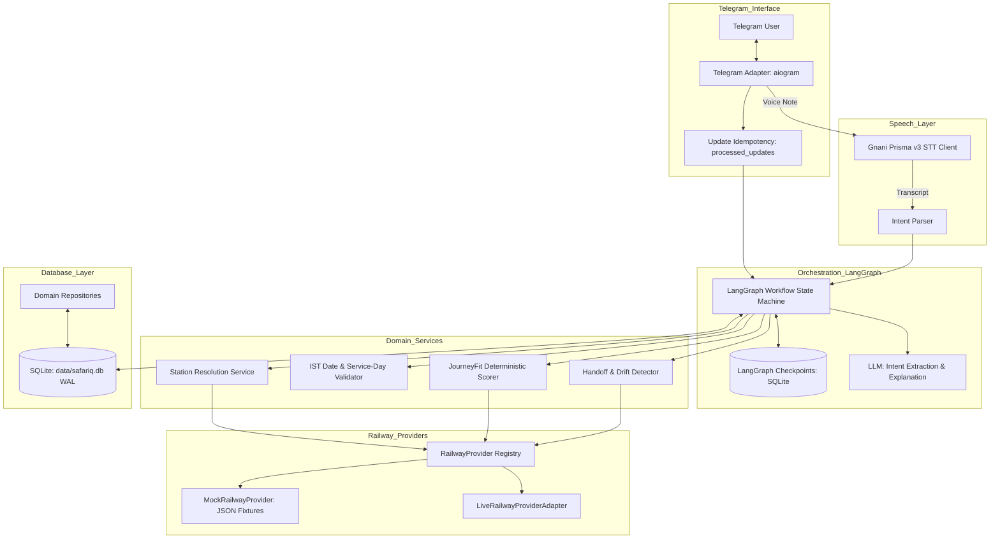

# Design

## Context

SAFARIQ is designed as a conversational Indian railway journey assistant operating over Telegram with voice support powered by Gnani Prisma v3. See `proposal.md` for motivation and product context.

The technical environment requires a single-language Python 3.12+ backend, zero external database infrastructure dependencies (SQLite only with WAL mode), a clear separation between deterministic railway calculations and conversational AI, and a pluggable external provider architecture so that mock fixtures and live railway data providers can be swapped seamlessly without touching Telegram handlers or LangGraph nodes.

## Goals / Non-Goals

**Goals:**
- Provide a clean, modular repository layout separating API, Telegram adapters, speech services, LangGraph orchestration, domain logic, data providers, database persistence, and background scheduling.
- Enforce 100% deterministic domain logic for station resolution, date calculations in `Asia/Kolkata`, train run-day validation, fare arithmetic (in integer paise and `Decimal`), and JourneyFit multi-factor scoring.
- Implement a pluggable `RailwayProvider` abstraction with capability flags, a complete `MockRailwayProvider` with realistic fixtures (Bokaro-Delhi and common routes), and strict provenance tagging (`provider_id`, `retrieved_at`, `is_demo`).
- Enable stateful multi-turn conversational workflows via LangGraph with SQLite checkpoints (`langgraph-checkpoint-sqlite` and `aiosqlite`), supporting interrupts for station and constraint clarification.
- Provide Telegram update idempotency via `processed_updates` to prevent duplicate message handling and double-processing of callback queries.
- Deliver a safe official booking handoff that revalidates fare and availability, detects price/seat drift, and directs travellers to an allowlisted official IRCTC portal without ever capturing credentials or claiming ticket booking.

**Non-Goals:**
- Automated ticket purchase, IRCTC account login, CAPTCHA bypass, OTP interception, or payment processing.
- Multi-node horizontal scaling or external infrastructure dependencies (no Redis, Celery, Postgres, or Kafka).
- Client-side or unauthenticated direct calls to Gnani or Railway APIs.
- Fabricating live railway availability, fares, or confirmation probabilities.

## Decisions

### Decision 1: Single-Language Python Architecture with FastAPI & Telegram Framework
- **Rationale**: Python 3.12+ provides first-class support for Gnani AI APIs, Pydantic v2 validation, LangGraph workflow orchestration, and robust date/math handling. FastAPI provides application lifecycle management and health check endpoints, while an async Telegram bot framework (`aiogram` or `python-telegram-bot`) handles messaging and inline callbacks.
- **Alternatives Considered**: Node.js/TypeScript backend was considered, but rejected due to weaker Python-centric AI/LangGraph ecosystem alignment and existing Gnani Python tooling.

### Decision 2: Pluggable `RailwayProvider` Protocol with Mock Implementation
- **Rationale**: External railway API providers in India frequently have varying capabilities, authentication requirements, rate limits, and terms. Decoupling the domain logic through a typed `RailwayProvider` protocol ensures that the application functions completely offline in `DEMO_MODE=true` using verified fixtures, while allowing live providers (e.g., RailKit, Qrail, RailRadar) to be plugged in once verified.
- **Alternatives Considered**: Direct API client calls within LangGraph nodes or handlers. Rejected because it tightly couples the bot to external provider schemas and prevents offline testability.

### Decision 3: SQLite with WAL Mode and Async SQLAlchemy
- **Rationale**: To satisfy hackathon portability and eliminate heavyweight services like Postgres or Redis, SQLite is used for both application records (users, trips, search sessions, quotes, handoffs) and LangGraph checkpoints (`aiosqlite`). WAL mode (`PRAGMA journal_mode = WAL`) and `busy_timeout = 5000` enable concurrent readers and smooth writes.
- **Alternatives Considered**: In-memory storage was rejected because user conversations and monitoring jobs must survive service restarts. Postgres/Redis were rejected to keep setup simple and self-contained.

### Decision 4: Deterministic Domain Logic over LLM Calculations
- **Rationale**: Railway calculations (fare math, running day schedule matching, date arithmetic crossing midnight, station code matching) must be exact and auditable. The LLM is restricted to conversational understanding, intent parameter extraction, and natural-language explanations. Ranking scores and hard constraints are calculated strictly in Python code.
- **Alternatives Considered**: Asking an LLM to evaluate the "best train" directly from prompt text. Rejected because LLMs hallucinate prices, schedules, and seat statuses.

### Decision 5: Voice Pipeline via Gnani Prisma v3 REST API
- **Rationale**: Telegram audio files and voice notes are downloaded to temporary disk storage, validated for duration (under 30s) and size, and transcribed using Gnani Prisma v3 REST API with `indic-auto` language detection. Temporary files are deleted immediately after transcription. The transcript is fed directly into the shared intent parser, ensuring identical behavior for voice and text requests. If Gnani credentials are missing or errors occur, the system safely falls back to text prompts.
- **Alternatives Considered**: Streaming WebSocket STT. Rejected for MVP simplicity and network resilience on mobile/Telegram connections.

### Decision 6: Allowlisted IRCTC Handoff and Drift Detection
- **Rationale**: Because SAFARIQ does not book tickets, the handoff is the terminal action. When the user selects a train, the system executes a fresh quote check against the provider. If the price or seat status has changed, the user is alerted to the difference. The system prepares a copyable summary and provides an external link strictly pointing to `https://www.irctc.co.in/nget`.
- **Alternatives Considered**: Deep-linking directly into IRCTC pre-filled carts. Rejected because IRCTC does not publish a supported, stable public URL schema for deep pre-filled carts.

## Architecture and Component Flow

## Risks / Trade-offs

- **[Provider Access / Credential Delay]** → Provide complete `MockRailwayProvider` with realistic Bokaro-Delhi fixtures and visible "DEMO DATA" banners so all workflows and tests function immediately.
- **[Seat Availability & Fare Volatility]** → Trigger a pre-handoff revalidation before presenting the final summary; require user acknowledgement if the fare or availability changed.
- **[Station Ambiguity]** → Normalized station master with aliases and fuzzy matching; present interactive inline buttons for terminal disambiguation (e.g., Delhi NDLS/DLI/NZM/ANVT) before searching.
- **[SQLite Concurrency Locks]** → Configure WAL mode, 5000ms busy timeout, and ensure no database transactions remain open across asynchronous HTTP or LLM calls.
- **[Telegram Rate Limits]** → Bound outbound messages, answer callback queries immediately with `answerCallbackQuery`, and enforce message editing instead of spamming new messages.

## Migration & Deployment Plan

1. **Environment Setup**: Initialize Python virtual environment with dependencies defined in `pyproject.toml`.
2. **Database Initialization**: Execute schema creation via `scripts/init_db.py` or Alembic migrations to set up WAL pragmas, tables, and indexes.
3. **Seed Data**: Run `scripts/seed_demo_data.py` to populate station master records and mock train fixtures.
4. **Configuration**: Copy `.env.example` to `.env`, configuring `DEMO_MODE=true` initially, with Telegram bot token and Gnani API credentials.
5. **Runtime**: Start FastAPI server with background Telegram polling for local development or webhook mode for production deployment.

## Open Questions

- Selection of approved live railway data provider and commercial display terms (tracked in `docs/INTEGRATION_BLOCKERS.md`).
- Optional stretch feature: Opt-in Journey Watch status monitoring schedule cadence (to be evaluated once live status endpoints are confirmed).
